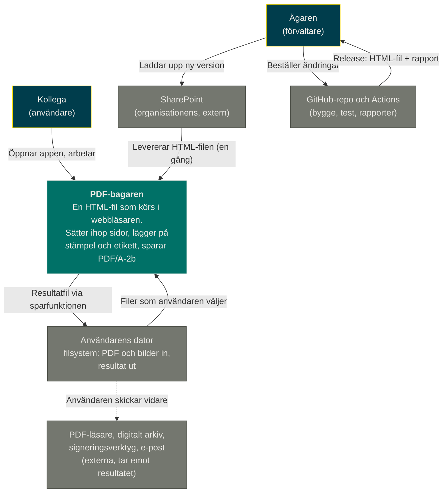
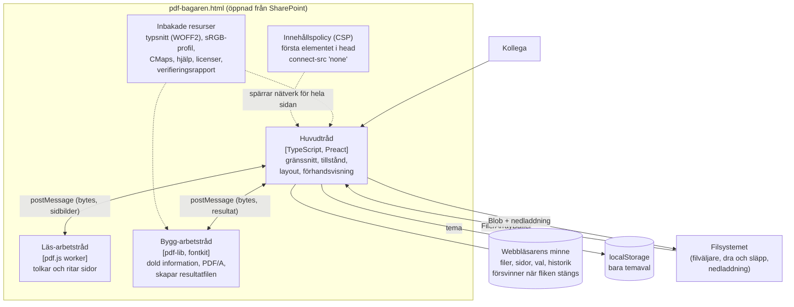
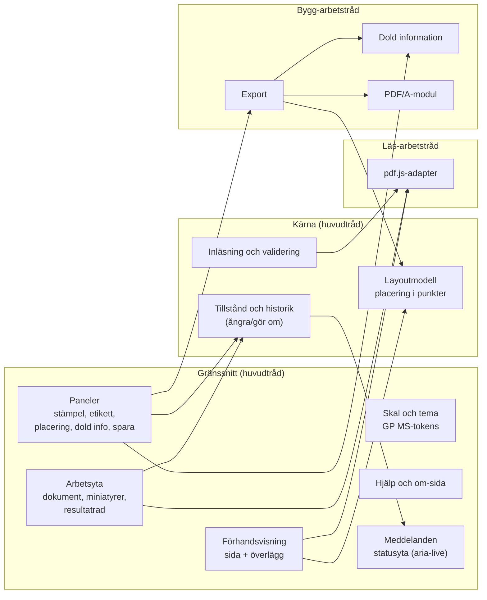
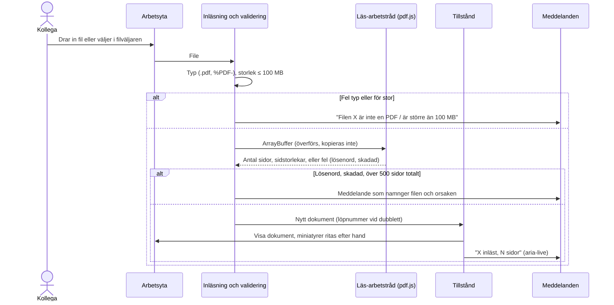
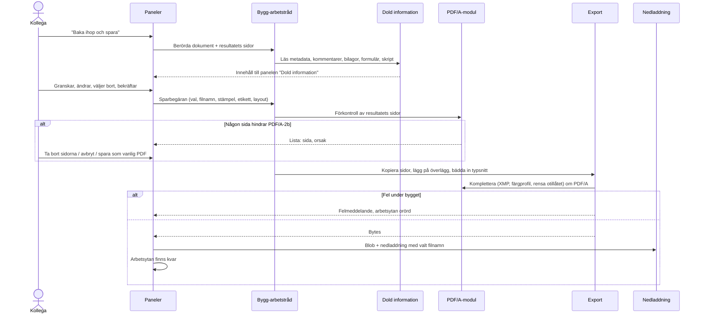
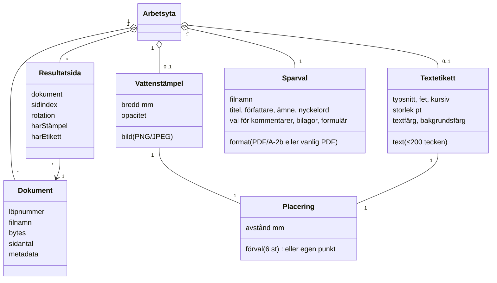

# Arkitektur: PDF-bagaren

> Status: Approved (G2, 2026-11-12) · Version 1.0.1 (risk nedgraderad 2026-11-12) · Senast uppdaterad: 2026-11-12 · Författare: Claude tillsammans med Ägaren
> Underlag: [docs/srs.md](srs.md) v1.0 (G1 godkänd), [docs/use-cases.md](use-cases.md) v1.0, [docs/systemkontext.md](systemkontext.md) v1.0

## 1. Inledning och mål

PDF-bagaren är en fristående webbapp som sätter samman valda sidor ur flera PDF-filer och lägger en vattenstämpel (bild) och en textetikett på valda sidor. Allt sker i användarens webbläsare. Krav, användare och avgränsning beskrivs i [srs.md](srs.md); det här dokumentet beskriver *hur* kraven uppfylls och *varför* lösningen ser ut som den gör.

**Kvalitetsmål i prioritetsordning** (Ägarens rangordning vid G0):

1. **Ingen information lämnar datorn** [NFR-SEC-001, NFR-SEC-002, NFR-PRIV-001, NFR-PRIV-002, FR-ALM-008]. Allt körs lokalt och en teknisk spärr i filen stoppar alla nätverksanrop.
2. **Användbarhet och tillgänglighet** [NFR-USE-001, NFR-ACC-001, NFR-ACC-002, NFR-PERF-001]. Förhandsvisningen ska stämma med resultatet och svara inom en sekund; allt ska gå med tangentbord och skärmläsare.
3. **Enkel publicering och förvaltning** [NFR-MAINT-001..004]. En enda HTML-fil läggs upp på SharePoint; Ägaren förvaltar med hjälp av Claude.

Därtill gäller hårda ramar: sidornas innehåll ändras inte [BG-009, FR-SPA-007], resultatet blir PDF/A-2b när sidorna tillåter det [NFR-COMP-004, FR-SPA-004], bara tillåtande licenser [NFR-LEG-001] och prestandamåtten [NFR-PERF-002..004].

**Intressenter** (se systemkontext): Ägaren (beställare och förvaltare, bryr sig om att inget läcker och att det är lätt att publicera), kollegorna (användare utan särskild datorvana, bryr sig om att det är enkelt och att resultatet blir rätt), mottagarna och arkivet (bryr sig om ett giltigt och läsbart format) samt organisationen (grafisk profil, tillgänglighet, informationssäkerhet).

## 2. Begränsningar

| Begränsning | Källa | Följd för arkitekturen |
| :-- | :-- | :-- |
| Inga dokument eller delar av dem lämnar datorn | BG-001 | Ingen server, ingen molntjänst, ingen telemetri; nätverksspärr i filen |
| Allt inbakat, inget hämtas vid användning | BG-007, NFR-MAINT-001 | Bibliotek, typsnitt, färgprofil och hjälptexter ligger i HTML-filen |
| Bara tillåtande licenser, inte GPL/AGPL | BG-008, NFR-LEG-001 | Utesluter t.ex. MuPDF och Ghostscript (AGPL); licenskontroll i bygget |
| Sidornas innehåll ändras inte | BG-009, FR-SPA-007 | Sidor kopieras som PDF-objekt; inget omritas, rastreras eller OCR-behandlas |
| Publicering genom uppladdning till SharePoint, utan server eller installation | BH-016, IF-05 | Statisk fil; ingen inloggning eller behörighet i appen (SharePoint sköter åtkomst) |
| Edge Måste, Safari på Mac Bör, datorskärm från 1 280 × 720 | NFR-COMP-001..003 | Bara standard-API:er som finns i båda motorerna; inga Chromium-specifika API:er som krav |
| WCAG 2.1 AA | BG-004, NFR-ACC-001 | Semantisk HTML, tangentbordsalternativ till dra och släpp, statusmeddelanden |
| GP MS, mörkt tema som standard | FV-002, NFR-USE-002, FR-ALM-009 | Designtokens ur GP MS; Carlito inbakad som reserv för Calibri |
| Team: Ägaren (skriver ingen kod) och Claude | UB-01 | Få beroenden, vanlig och väldokumenterad teknik, automatiska tester som skyddsnät |
| Ingen budget för licenser eller drift | Underförstått av BH-016 | Bara fri programvara och gratis verktyg (GitHub) |

## 3. Kontext och avgränsning

**Externa gränssnitt** (från SRS 3.2): IF-01 PDF in och IF-02 bild in, båda bara via filväljare eller dra och släpp; IF-03 resultatfil ut via webbläsarens nedladdning; IF-04 webbläsaren; IF-05 SharePoint, som bara levererar filen; IF-06 mottagande system, som appen aldrig talar med direkt. Efter laddning har appen inga nätverksgränssnitt alls (SRS 3.2.4).

**Utanför systemet:** åtkomst till appen (SharePoint), spår i webbläsarens cache och nedladdningshistorik (OM-09, organisationen), digital signering och arkivering (görs efteråt med andra verktyg).

## 4. Lösningsstrategi

1. **En fristående klientapp i en enda HTML-fil**, utan server. All kod, alla bibliotek, typsnitt och texter är inbakade. → [ADR-001](#adr-001-fristående-klientapp-i-en-enda-html-fil)
2. **Nätverksspärr på två nivåer**: en strikt innehållspolicy (CSP) överst i filen som förbjuder alla anslutningar, och kodregler som förbjuder nätverks-API:er. → [ADR-002](#adr-002-nätverksspärr-med-innehållspolicy-och-kodregler)
3. **pdf.js (Mozilla, Apache 2.0) läser och visar** PDF:er, med skript och eval avstängda, i en egen arbetstråd. → [ADR-003](#adr-003-pdfjs-för-inläsning-och-förhandsvisning)
4. **pdf-lib (Cantoo-forken, MIT) bygger resultatet** genom att kopiera sidobjekten oförändrade och lägga ett eget innehållslager ovanpå. → [ADR-004](#adr-004-pdf-lib-för-att-bygga-resultatet-utan-att-röra-sidinnehållet)
5. **En egen PDF/A-modul** kontrollerar sidorna före sparande och kompletterar filen (XMP-metadata, färgprofil, rensning av otillåtet). veraPDF i testerna avgör. → [ADR-005](#adr-005-egen-pdfa-2b-modul-med-förkontroll-och-verapdf-i-testerna)
6. **En gemensam layoutmodell** i PDF-punkter räknar ut stämpelns och etikettens placering, och används av både förhandsvisning och export. → [ADR-006](#adr-006-gemensam-layoutmodell-för-förhandsvisning-och-export)
7. **Tre inbakade typsnittsfamiljer med fyra snitt var** (Carlito, Liberation Serif, Liberation Mono; SIL OFL 1.1), samma filer för skärm och PDF. → [ADR-007](#adr-007-inbakade-typsnitt-för-etiketter-och-gränssnitt)
8. **TypeScript med Preact** i gränssnittet och ett eget litet tillståndslager i minnet med ångra-historik; ingen beständig lagring utom temavalet. → [ADR-008](#adr-008-typescript-och-preact-tillstånd-bara-i-minnet)
9. **Vite bygger till en fil**; Vitest och Playwright (Chromium och WebKit) testar; GitHub Actions bygger, testar, kontrollerar licenser och sårbarheter och tar fram underlag till verifieringsrapporten. → [ADR-009](#adr-009-bygge-och-tester-vite-vitest-playwright-och-github-actions), [ADR-010](#adr-010-release-och-publicering-med-verifieringsrapport)

## 5. Byggblock

### 5.1 Behållare (C4 nivå 2)

Arbetstrådarna skapas från inbakad kod via `blob:`-adresser, så de laddar inget utifrån. Tunga operationer (tolkning, ritning, export) går i arbetstrådar så att gränssnittet, väntindikatorn och skärmläsarens statusmeddelanden fortsätter att fungera [FR-FIL-011, FR-SPA-011, NFR-PERF-001].

### 5.2 Komponenter (C4 nivå 3)

| Byggblock | Ansvar | Krav (urval) | Beroenden |
| :-- | :-- | :-- | :-- |
| **Skal och tema** | Sidlayout i ett fönster, GP MS-tokens för mörkt och ljust tema, kortkommandon | FR-ALM-005, FR-ALM-007, FR-ALM-009, FR-ALM-010, NFR-USE-002, NFR-COMP-003 | Typsnitt |
| **Arbetsyta** | Dokumentlista, miniatyrer, resultatrad, dra och släpp med tangentbordsalternativ | FR-FIL-001..005, FR-FIL-012, FR-SID-001..014 | Tillstånd, pdf.js-adapter |
| **Förhandsvisning** | En resultatsida i taget med stämpel, etikett och säkerhetsmarginal ritade ovanpå | FR-FHV-001..010, FR-PLC-002, FR-PLC-003, FR-PLC-009 | pdf.js-adapter, layoutmodell |
| **Paneler** | Inställningar för stämpel, etikett, placering, dold information och sparande | FR-STA-*, FR-TXT-*, FR-PLC-*, FR-DOL-*, FR-SPA-001..003, FR-SPA-010 | Tillstånd, bygg-arbetstråd |
| **Hjälp och om-sida** | Hjälptexter, licensförteckning, verifieringsrapport, tillgänglighetsredogörelse | FR-DOK-001..010 | Inbakade resurser (genereras i bygget) |
| **Meddelanden** | Ett ställe för alla fel-, varnings- och statusmeddelanden på svenska; läses upp av skärmläsare | FR-ALM-006, FR-FIL-013, FR-SID-014, BH-020 | – |
| **Tillstånd och historik** | Arbetsytans modell (se 8.2) och ångra-stack; bara i minnet | FR-ALM-001..004, FR-ALM-008, FR-SPA-013 | – |
| **Layoutmodell** | Räknar ut stämpelns och etikettens ruta på varje sida ur förval, avstånd och sidstorlek; håller objekt innanför kanten och flaggar sidor där de krockar med marginalen | FR-PLC-001, FR-PLC-004..008, FR-PLC-010, FR-PLC-011, FR-SPA-008 | Typsnittsmetrik |
| **Inläsning och validering** | Kontrollerar filtyp, storlek, lösenordsskydd, skadad fil och sidgräns innan något läggs till | FR-FIL-006..010, FR-STA-011 | pdf.js-adapter |
| **pdf.js-adapter** | Öppnar PDF:er säkert, ritar miniatyrer och sidor, ger sidstorlek och rotation | FR-FIL-002, FR-FHV-*, NFR-SEC-003, NFR-PERF-001, NFR-PERF-002 | pdf.js |
| **Dold information** | Läser metadata, kommentarer, bifogade filer, formulärfält, skript; tillämpar användarens val | FR-DOL-001..015 | pdf-lib |
| **PDF/A-modul** | Förkontroll av sidor mot PDF/A-2b och komplettering av den färdiga filen | FR-SPA-004..006, FR-DOL-010, FR-DOL-012, NFR-COMP-004 | pdf-lib, sRGB-profil |
| **Export** | Kopierar sidor, lägger på stämpel och etikett, bäddar in typsnitt, skriver filen | FR-SPA-001, FR-SPA-007..009, FR-SPA-012, FR-STA-002, NFR-PERF-003 | pdf-lib, fontkit, layoutmodell |

## 6. Körning

### 6.1 Läsa in en fil [UC-001]

Undantagsflödena i UC-001 ger arkitekturens regel för fel: **ett fel rör bara den fil det gäller**, övriga filer och val är oförändrade [FR-FIL-007, BH-020]. Inläsningen validerar därför helt innan tillståndet ändras, och varje fil hanteras för sig.

### 6.2 Ändra placering och se resultatet [UC-005, UC-003, UC-004]

Varje ändring (t.ex. piltangent på stämpeln) blir en ny version av tillståndet och en post i ångra-historiken. Förhandsvisningen ritar om bara överlägget; sidan själv är redan ritad och cachad som bild i minnet. Därför ryms ändringen inom en sekund även för stora sidor [NFR-PERF-001]. Layoutmodellen räknar ut rutan i PDF-punkter och förhandsvisningen skalar den till skärmen; exporten använder exakt samma ruta.

### 6.3 Baka ihop och spara [UC-006, UC-007]

Undantagsflödena i UC-007 (sida som hindrar PDF/A-2b, fel under bygget) är skälet till att förkontrollen körs **före** bygget och att bygget arbetar på kopior av indata, så att ett fel aldrig ändrar arbetsytan [FR-SPA-005, FR-SPA-012].

## 7. Driftsättning

Det finns ingen server och ingen infrastruktur att driva. Miljöer i befordringsordning:

| Miljö | Var | Syfte |
| :-- | :-- | :-- |
| Test | En SharePoint-mapp som bara Ägaren (och utvalda testare) når | Kontrollera att filen körs på SharePoint, mäta starttid, köra nätverksloggskontrollen och användartestet (NFR-USE-001) |
| Produktion | Den gemensamma SharePoint-sidan | Kollegornas användning |

GitHub Actions bygger HTML-filen, kör alla tester och tar fram releasepaketet (HTML-fil, licensförteckning, testresultat till verifieringsrapporten). Ägaren laddar själv upp filen, först till test och sedan till produktion, enligt förvaltningsinstruktionen [NFR-MAINT-002, UC-010]. Inget publiceras automatiskt till SharePoint, eftersom appen inte ska ha några kopplingar till organisationens system.

## 8. Tvärgående principer

### 8.1 Säkerhet och integritet

- **Inga data ut** [NFR-SEC-001, NFR-SEC-002, NFR-PRIV-001]. CSP-taggen överst i filen: `default-src 'none'; script-src 'sha256-…'; style-src 'unsafe-inline'; img-src blob: data:; font-src data: blob:; worker-src blob:; connect-src 'none'; form-action 'none'; base-uri 'none'`. Ingen `unsafe-eval`. (Behöver pdf.js WebAssembly för vissa bildformat tillkommer `'wasm-unsafe-eval'`, som bara tillåter kompilering av inbakad WebAssembly; bestäms i detaljdesignen.) Kodregler i bygget förbjuder `fetch`, `XMLHttpRequest`, `WebSocket`, `EventSource`, `navigator.sendBeacon` och externa adresser. Ingen telemetri, inga felrapporter.
- **Ingen beständig lagring av dokumentdata** [FR-ALM-008, NFR-PRIV-002]. Allt ligger i minnet. Det enda som sparas i webbläsaren är temavalet (en nyckel i localStorage). Blob-adresser för nedladdning och miniatyrer frisläpps när de inte behövs.
- **Aktivt innehåll körs aldrig** [NFR-SEC-003]. pdf.js används med `enableScripting: false` och `isEvalSupported: false`, och skriptmodulen byggs inte in. Exporten tar bort JavaScript, startåtgärder och liknande ur resultatet [FR-DOL-012].
- **Bibliotekens säkerhet** [NFR-SEC-004]. Exakta versioner låses i `package-lock.json`. Bygget stoppas om en sårbarhetskontroll (npm audit och OSV) hittar hög eller kritisk sårbarhet i ett inbakat bibliotek.
- **Lösenordsskyddade filer** avvisas [FR-FIL-008]; resultatet krypteras aldrig [FR-SPA-009].

### 8.2 Data

Ingen databas. En konceptuell domänmodell i minnet, som detaljdesignen bygger vidare på:

Tillståndet är oföränderligt (varje ändring ger en ny version), vilket gör ångra och gör om enkelt [FR-ALM-001, FR-ALM-002]. Filernas bytes delas mellan versionerna och kopieras inte.

### 8.3 Fel och motståndskraft

- Varje fil valideras för sig och felet stannar vid den filen [FR-FIL-006..010].
- Bygget arbetar på kopior och ändrar aldrig arbetsytan; ett fel ger ett meddelande och arbetsytan finns kvar [FR-SPA-012, FR-SPA-013].
- Alla meddelanden går genom ett och samma byggblock med texter på svenska som anger vad som hände och hur man går vidare [FR-ALM-006].
- Om webbläsaren får slut på minne vid mycket stora filer fångas felet och visas som ett meddelande; gränserna 100 MB per fil och 500 sidor totalt är satta för att undvika det.
- Vid stängning av fliken med osparat arbete frågar webbläsaren först [FR-ALM-004].

### 8.4 Observerbarhet

Avsiktligt ingen loggning till någon tjänst och ingen statistik [NFR-PRIV-001]. Felsökning sker genom att Ägaren återskapar felet med en testfil och beskriver det; utvecklaren kan använda webbläsarens konsol lokalt. Versionsnummer och versionsdatum visas på om-sidan så att man vet vilken version som används [FR-DOK-004].

### 8.5 Prestanda

- Miniatyrer ritas i låg upplösning och i bakgrunden, synliga först [NFR-PERF-002].
- Förhandsvisningens sida ritas en gång per sida och skala och cachas; bara överlägget ritas om vid ändringar [NFR-PERF-001].
- Export i egen arbetstråd; typsnitt bäddas in som delmängd med bara de tecken som används [NFR-PERF-003].
- Starttid: filen hålls så liten som möjligt (typsnitt i WOFF2, bara nödvändiga delar av pdf.js) och arbetstrådarna startas först när de behövs [NFR-PERF-004]. Målet är en fil under 8 MB; storleken mäts i varje bygge.

### 8.6 Tillgänglighet och gränssnitt

- Semantiska HTML-element och WAI-ARIA-mönster: resultatraden är en lista där sidor flyttas med knappar och kortkommandon som alternativ till dra och släpp [FR-SID-007, FR-SID-008, NFR-ACC-002].
- En statusyta med `aria-live` för utfall av inläsning, flytt och sparande [FR-FIL-013, FR-SID-014].
- Förhandsvisade sidor och miniatyrer får namn i formen "Sida N av M ur <dokumentnamn>" [FR-DOK-010].
- GP MS-färgerna läggs som designtokens (CSS-variabler) för mörkt och ljust tema; fokusmarkering i gult. Typsnittsstacken `Calibri, Carlito, "Segoe UI", Arial, sans-serif` med Carlito inbakad [NFR-USE-002].
- Detaljerad skärmdesign tas fram i UX-steget (ux-foundations).

### 8.7 Tester

- **Form:** många enhetstester för kärnan (layoutmodell, validering, tillstånd, dold information, PDF/A-förkontroll), integrationstester som bygger riktiga PDF:er ur testfilerna i repot och kontrollerar dem, och ett mindre antal end-to-end-tester i webbläsare. Varje Must-krav får minst ett automatiskt test [NFR-MAINT-004].
- **Ramverk:** Vitest för enhets- och integrationstester; Playwright för end-to-end i Chromium (samma motor som Edge) och WebKit (samma motor som Safari); axe-core för automatisk tillgänglighetskontroll; veraPDF i CI för att validera PDF/A-2b [NFR-COMP-004]. [ADR-009]
- **Kritiska flöden i end-to-end:** DS-01 beslut med inskannad namnteckning (UC-001, UC-002, UC-003, UC-007), DS-02 märka en PDF (UC-001, UC-004, UC-005, UC-007), granska dold information (UC-006), felbesked (UC-001 undantag), ångra (UC-008). Alla körs även med bara tangentbord.
- **Särskilda kontroller:** nätverksspärren (testet lyssnar på alla förfrågningar och kräver noll efter laddning, NFR-SEC-002); oförändrat sidinnehåll (sidornas innehållsflöden i resultatet jämförs byte för byte med källan, BG-009); skriptfil körs inte (NFR-SEC-003); jämförelse mellan förhandsvisning och resultat (resultatet ritas och jämförs med förhandsvisningen, MF-02).
- **Manuella kontroller före release:** skärmläsartest med NVDA i Edge och VoiceOver i Safari [NFR-ACC-002], visning i Acrobat Reader och Förhandsvisning [NFR-COMP-005], start från test-SharePoint och användartestet [NFR-USE-001].
- **Täckning:** rapporteras (Vitest med v8) men ingen tröskel som stoppar bygget. Drivare: kravet är ett test per Must-krav (NFR-MAINT-004), vilket kontrolleras via RTM, inte via procent.

### 8.8 Testbara arkitekturregler

Följande regler kontrolleras automatiskt i bygget:

- `[testable]` R1: Ingen produktkod använder nätverks-API:er (`fetch`, `XMLHttpRequest`, `WebSocket`, `EventSource`, `sendBeacon`) eller externa adresser. (ADR-002)
- `[testable]` R2: Den byggda filen har CSP-taggen som första element i `head` med `connect-src 'none'` och `default-src 'none'`, och inga `<script src>` eller `<link href>` mot andra adresser. (ADR-002)
- `[testable]` R3: Bara temamodulen använder `localStorage`; ingen kod använder `sessionStorage`, IndexedDB eller Cache API. (ADR-008)
- `[testable]` R4: Förhandsvisning och export hämtar placering bara från layoutmodellen. (ADR-006)
- `[testable]` R5: Alla produktberoenden och typsnitt har licens på vitlistan (MIT, BSD, ISC, Apache-2.0, OFL-1.1, CC0-1.0). (ADR-009)
- `[testable]` R6: pdf.js öppnas bara via adaptern, med `enableScripting: false` och `isEvalSupported: false`. (ADR-003)
- `[testable]` R7: Bygget ger exakt en HTML-fil och inga andra filer behövs för att köra den. (ADR-001)
- `[testable]` R8: Kopierade sidors innehållsflöden är oförändrade i resultatet. (ADR-004)

## 9. Arkitekturbeslut

### ADR-001: Fristående klientapp i en enda HTML-fil

**Status:** Accepted
**Datum:** 2026-11-12
**Requirements addressed:** NFR-MAINT-001, NFR-MAINT-002, NFR-PERF-004, NFR-SEC-001, NFR-PRIV-002, NFR-COMP-001, NFR-COMP-002, FR-SPA-001, FR-ALM-008

**Kontext**
Dokumenten får aldrig lämna datorn (BG-001), appen ska publiceras genom att läggas upp på SharePoint utan server eller installation (BH-016) och allt ska vara inbakat (BG-007). Ägaren förvaltar själv och skriver ingen kod.

**Beslut**
Vi bygger en ren klientapp som levereras som en enda HTML-fil. All bearbetning sker i webbläsaren. Ingen server, inga API:er, inga molntjänster.

**Alternativ**
- **En HTML-fil (vald)** – en sak att ladda upp och versionera; inget kan läcka till en server eftersom det inte finns någon. Nackdel: filen blir några megabyte och allt måste rymmas i webbläsarens minne.
- **Flera statiska filer i en SharePoint-mapp** – mindre huvudfil. Nackdel: fler filer att hålla ihop vid publicering, och SharePoint kan hantera relativa adresser och filtyper olika. Föll på enkel publicering.
- **Webbserver i organisationen** – kraftfullare PDF-verktyg på serversidan. Nackdel: dokument lämnar datorn, kräver drift och IT. Föll på BG-001 och BH-016.
- **Installerat program** – full tillgång till datorn. Nackdel: kräver installation och IT, strider mot BH-016.

**Konsekvenser**
Publicering är en filuppladdning. Datamängden begränsas av webbläsarens minne, därav gränserna 100 MB och 500 sidor. Att SharePoint kör HTML-sidor har Ägaren prövat (avsnitt 11). Omprövas om appen behöver funktioner som inte går att göra i en webbläsare.

### ADR-002: Nätverksspärr med innehållspolicy och kodregler

**Status:** Accepted
**Datum:** 2026-11-12
**Requirements addressed:** NFR-SEC-001, NFR-SEC-002, NFR-PRIV-001, NFR-PRIV-002, NFR-SEC-005, FR-DOK-005, FR-DOK-007

**Kontext**
Ägaren och informationssäkerhet ska kunna lita på att inget skickas, även om ett bibliotek innehåller kod som försöker ansluta (NFR-SEC-002 kräver en teknisk spärr). Spärren ska kunna verifieras i verifieringsrapporten.

**Beslut**
Vi lägger en strikt Content Security Policy som `<meta>`-tagg först i filen med `default-src 'none'` och `connect-src 'none'`, och tillåter bara inbakat innehåll (skript via hash, `blob:` och `data:`). Vi förbjuder nätverks-API:er i koden med lintregler (R1) och kontrollerar den byggda filen (R2). End-to-end-testet registrerar alla nätverksförfrågningar och kräver noll efter laddning.

**Alternativ**
- **CSP + kodregler + test (vald)** – webbläsaren själv stoppar anslutningar oavsett vilken kod som försöker. Kontrollerbart. Nackdel: CSP i en meta-tagg kan inte styra allt (t.ex. `frame-ancestors`), och en felaktig policy kan stoppa appens egna arbetstrådar; det fångas av testerna.
- **Bara kodgranskning** – inget tekniskt skydd mot beroenden som ansluter. Föll på NFR-SEC-002.
- **Begära CSP-huvud från SharePoint** – starkare, men kräver IT och är utanför Ägarens kontroll. Kan läggas till senare.

**Konsekvenser**
Inga externa resurser kan användas, inte ens typsnitt eller kartor; allt bakas in. Spärren och testet blir underlag till verifieringsrapporten. Om SharePoint skickar en egen, striktare policy kan den krocka med appens arbetstrådar; prövas i första bygget.

### ADR-003: pdf.js för inläsning och förhandsvisning

**Status:** Accepted
**Datum:** 2026-11-12
**Requirements addressed:** FR-FIL-002, FR-FIL-007, FR-FIL-008, FR-SID-001, FR-FHV-001, FR-FHV-006, NFR-SEC-003, NFR-PERF-001, NFR-PERF-002, NFR-COMP-001, NFR-COMP-002, NFR-LEG-001

**Kontext**
Appen behöver tolka godtyckliga PDF:er, upptäcka lösenordsskydd och skadade filer och rita sidor som miniatyrer och förhandsvisning i både Edge och Safari. Biblioteket måste ha tillåtande licens och inte köra skript i filerna.

**Beslut**
Vi använder pdf.js (`pdfjs-dist`, Apache 2.0) i en egen arbetstråd, via en adapter som alltid sätter `enableScripting: false` och `isEvalSupported: false` (R6) och som ger standardtypsnitt och CMaps från inbakade data i stället för från adresser.

**Alternativ**
- **pdf.js (vald)** – samma motor som Firefox PDF-visare, mycket använd, aktivt underhållen, fungerar i alla moderna webbläsare. Nackdel: stor kod, och sårbarheter upptäcks löpande (flera under 2026), vilket kräver uppdateringar.
- **MuPDF (WebAssembly)** – mycket bra återgivning. Föll på licens (AGPL).
- **PDFium (WebAssembly)** – samma motor som Edge, BSD-licens. Nackdel: inofficiella byggen, mindre stöd för användning i webbläsare, större fil. Möjlig ersättare om pdf.js återgivning visar sig avvika för mycket.

**Konsekvenser**
Förhandsvisningen ritas av pdf.js, medan mottagarna ser filen i Acrobat eller Edge; små skillnader i återgivning kan förekomma och prövas med referensfiler (NFR-COMP-005). pdf.js versioner följs och uppdateras inför varje release (NFR-SEC-004).

### ADR-004: pdf-lib för att bygga resultatet utan att röra sidinnehållet

**Status:** Accepted
**Datum:** 2026-11-12
**Requirements addressed:** FR-SPA-001, FR-SPA-007, FR-SPA-008, FR-SPA-009, FR-SID-010, FR-STA-002, FR-STA-004, FR-TXT-006, FR-DOL-004, FR-DOL-006, FR-DOL-007, FR-DOL-009, FR-DOL-011, FR-DOL-013, NFR-PERF-003, NFR-COMP-005, NFR-LEG-001

**Kontext**
Sidornas innehåll får inte ändras (BG-009): text ska förbli text och inskannade sidor förbli bilder. Stämpel och etikett ska ligga ovanpå med samma utseende som i förhandsvisningen, PNG-genomskinlighet och opacitet ska fungera, och metadata, kommentarer, bilagor och formulärfält ska kunna ändras eller tas bort.

**Beslut**
Vi använder pdf-lib i den underhållna forken `@cantoo/pdf-lib` (MIT) med `fontkit` (MIT). Sidor kopieras som PDF-objekt (`copyPages`) med sina resurser; stämpel och etikett läggs i ett **eget innehållsflöde efter** sidans befintliga flöden, med bild som XObject (alfakanal som SMask) och opacitet via ExtGState. Sidans egna innehållsflöden skrivs aldrig om (R8). Rotation sätts med sidans `/Rotate`-värde.

**Alternativ**
- **pdf-lib, Cantoo-forken (vald)** – ren JavaScript, MIT, arbetar på objektnivå så sidinnehållet kan lämnas orört; forken är underhållen medan originalet inte fått releaser sedan 2021. Nackdel: inget inbyggt stöd för PDF/A, och forken har en mindre användarbas.
- **Originalet pdf-lib** – större spridning. Nackdel: inte underhållet; kända fel rättas inte. Hålls som reserv eftersom API:et är detsamma.
- **qpdf eller PDFium i WebAssembly** – robustare hantering av trasiga filer. Nackdel: större fil, krångligare bygge, och för PDFium saknas skriv-API för det vi behöver. Omprövas om pdf-lib får problem med verkliga filer.

**Konsekvenser**
Kopiering på objektnivå uppfyller BG-009 per konstruktion. Kommentarer, formulärfält och bilagor hanteras direkt i PDF-objekten av byggblocket Dold information. pdf-lib klarar inte alla trasiga PDF:er som pdf.js kan visa; sådana filer ger ett felmeddelande vid sparande (FR-SPA-012) och samlas som testfall.

### ADR-005: Egen PDF/A-2b-modul med förkontroll och veraPDF i testerna

**Status:** Accepted
**Datum:** 2026-11-12
**Requirements addressed:** FR-SPA-004, FR-SPA-005, FR-SPA-006, FR-DOL-010, FR-DOL-012, NFR-COMP-004, NFR-LEG-001, UC-007

**Kontext**
Resultatet ska vara giltig PDF/A-2b (validerad med veraPDF) när sidorna tillåter det, och användaren ska varnas innan sparande när en sida hindrar det (t.ex. typsnitt som inte är inbäddade, otillåten komprimering, enhetsberoende färger som krockar med färgprofilen). Inget tillåtande JavaScript-bibliotek gör PDF/A-konvertering, och sidorna får inte göras om (BG-009).

**Beslut**
Vi bygger en egen modul i två delar. **Förkontrollen** går igenom resultatets sidor och deras resurser och listar hinder per sida med en begriplig orsak. **Kompletteringen** lägger till det filen själv behöver: XMP-metadata med PDF/A-identifiering och samma värden som dokumentinformationen, en OutputIntent med en inbakad sRGB-profil (CC0-licens), fil-ID, inbäddade och delmängdade typsnitt för etiketten, samt tar bort skript, otillåtna åtgärder och bilagor som inte är PDF/A. veraPDF körs i CI på alla testresultat; det är veraPDF, inte modulen, som avgör om kravet är uppfyllt.

**Alternativ**
- **Egen modul + veraPDF i CI (vald)** – full kontroll, inget extra beroende i appen. Nackdel: modulen måste underhållas och kan missa ovanliga hinder; veraPDF i testerna fångar det för testfilerna, inte för varje verklig fil.
- **Validera i appen med veraPDF** – veraPDF är Java och GPL/MPL; går inte att baka in. Föll på licens och teknik.
- **Konvertera med Ghostscript** – kan göra om nästan allt till PDF/A. Föll på licens (AGPL) och på att det skriver om sidinnehåll (BG-009).

**Konsekvenser**
Filer med hinder kan sparas som vanlig PDF (FR-SPA-006) i stället för att sidan görs om. Hur ofta det händer i verkligheten vet vi inte; förkontrollens listor av orsaker bör följas upp efter första releasen. Förkontrollen kan inte garantera giltighet för varje tänkbar fil; det framgår av verifieringsrapporten.

### ADR-006: Gemensam layoutmodell för förhandsvisning och export

**Status:** Accepted
**Datum:** 2026-11-12
**Requirements addressed:** FR-FHV-006, FR-SPA-008, FR-PLC-001, FR-PLC-004, FR-PLC-005, FR-PLC-006, FR-PLC-007, FR-PLC-008, FR-PLC-010, FR-PLC-011, FR-TXT-013, NFR-PERF-001

**Kontext**
Det viktigaste måttet på framgång är att förhandsvisningen stämmer med resultatet (MF-02). Sidor kan ha olika storlek och riktning, och placeringen ska följa förval och avstånd i millimeter.

**Beslut**
Vi har en ren funktion som, givet sidans storlek och rotation, objektets mått, förval, avstånd och eventuell egen punkt, ger objektets ruta i PDF-punkter. Både förhandsvisningen (som skalar till skärmen) och exporten (som skriver i PDF) använder den, och inget annat ställe räknar ut placering (R4). Textens bredd räknas med samma typsnittsmetrik (fontkit) i båda.

**Alternativ**
- **En gemensam funktion (vald)** – en enda sanning, lätt att testa med enhetstester för alla förval och sidformat. Nackdel: förhandsvisningen kan inte använda webbläsarens textlayout fritt, utan ritar texten med kända mått.
- **Separat logik för skärm och PDF** – enklare var för sig. Föll på risken för avvikelser, som är just det som MF-02 mäter.

**Konsekvenser**
Avvikelser mellan förhandsvisning och resultat begränsas till hur pdf.js ritar sidan i sig. Layoutmodellen blir den mest testade delen av koden.

### ADR-007: Inbakade typsnitt för etiketter och gränssnitt

**Status:** Accepted
**Datum:** 2026-11-12
**Requirements addressed:** FR-TXT-003, FR-TXT-007, FR-TXT-008, FR-TXT-013, NFR-USE-002, NFR-LEG-001, NFR-COMP-004, NFR-MAINT-001

**Kontext**
Etiketter ska kunna vara fet och kursiv (FR-TXT-008, Must) i ett sans-serif-, ett serif- och ett typsnitt med fast bredd (FR-TXT-007). Typsnitt måste bäddas in i PDF/A och ha tillåtande licens. GP MS anger Calibri, som inte får bäddas in, och Carlito som reserv.

**Beslut**
Vi bakar in Carlito, Liberation Serif och Liberation Mono, alla SIL OFL 1.1, i fyra snitt var (normal, fet, kursiv, fet kursiv). Samma typsnittsfiler används för gränssnittet (Carlito), förhandsvisningen och PDF-inbäddningen, där bara de tecken som används bäddas in. Filerna lagras som WOFF2 för att hålla nere storleken.

**Alternativ**
- **Carlito + Liberation Serif + Liberation Mono (vald)** – metriskt kompatibla med Calibri, Times New Roman och Courier New, så etiketter ser ut som kollegorna förväntar sig; OFL; täcker svenska tecken. Nackdel: tolv filer gör appen större.
- **Bara Carlito** – minsta fil. Föll på FR-TXT-007 (Should, men lätt att uppfylla).
- **PDF:s standardtypsnitt (Helvetica m.fl.) utan inbäddning** – ingen storlek. Föll på PDF/A, som kräver inbäddade typsnitt.

**Konsekvenser**
Tecken utanför typsnittets teckenuppsättning upptäcks med fontkit och varnas för (FR-TXT-013). Licensförteckningen på om-sidan tar med typsnitten (FR-DOK-006).

### ADR-008: TypeScript och Preact, tillstånd bara i minnet

**Status:** Accepted
**Datum:** 2026-11-12
**Requirements addressed:** FR-ALM-001, FR-ALM-002, FR-ALM-003, FR-ALM-008, FR-ALM-009, FR-SID-007, FR-SID-008, FR-DOK-010, NFR-ACC-001, NFR-ACC-002, NFR-COMP-003, NFR-MAINT-004, NFR-PERF-004

**Kontext**
Gränssnittet har en arbetsyta med flera paneler som påverkar varandra, ångra och gör om, och höga krav på tillgänglighet. Koden förvaltas av Ägaren med Claude, så den ska vara lätt att läsa och ändra och ha få beroenden. Filen ska starta snabbt.

**Beslut**
Vi skriver i TypeScript med Preact (MIT, cirka 4 kB) för komponenterna och ett eget litet tillståndslager med oföränderliga versioner och ångra-stack. Tillgänglighet byggs med vanliga HTML-element och dokumenterade WAI-ARIA-mönster, utan komponentbibliotek. Bara temavalet sparas i webbläsaren (R3).

**Alternativ**
- **TypeScript + Preact (vald)** – komponenter och tydlig struktur, liten storlek, välkänt för Claude. Nackdel: ett beroende till.
- **TypeScript utan ramverk** – minst beroenden. Nackdel: mer egen kod för att hålla gränssnittet i takt med tillståndet; svårare att förvalta.
- **React eller ett komponentbibliotek** – mest dokumentation. Nackdel: större fil, och komponentbibliotek tar med egna stilar som krockar med GP MS.

**Konsekvenser**
Typkontrollen och testerna fångar många fel innan Ägaren ser dem. Tillståndet försvinner när fliken stängs, vilket är avsikten (FR-ALM-008); därför finns varningen vid stängning (FR-ALM-004).

### ADR-009: Bygge och tester: Vite, Vitest, Playwright och GitHub Actions

**Status:** Accepted
**Datum:** 2026-11-12
**Requirements addressed:** NFR-MAINT-001, NFR-MAINT-004, NFR-LEG-001, NFR-SEC-004, NFR-COMP-001, NFR-COMP-002, NFR-COMP-004, NFR-ACC-001

**Kontext**
Allt ska bli en fil (NFR-MAINT-001), varje Must-krav ska ha ett automatiskt test (NFR-MAINT-004), licenser och sårbarheter ska kontrolleras (NFR-LEG-001, NFR-SEC-004) och PDF/A ska valideras med veraPDF (NFR-COMP-004). Repot finns på GitHub.

**Beslut**
Vi bygger med Vite och `vite-plugin-singlefile` (båda MIT) så att skript, stilar, arbetstrådar och resurser bakas in i en HTML-fil. Vitest kör enhets- och integrationstester, Playwright kör end-to-end i Chromium och WebKit med axe-core för tillgänglighet, och veraPDF validerar sparade testfiler. GitHub Actions kör allt vid varje ändring, samt licens- och sårbarhetskontroll och kontrollerna R1–R8. Testverktygen ingår inte i appen och omfattas därför inte av licenskravet.

**Alternativ**
- **Vite + Vitest + Playwright (vald)** – vanlig och snabb kombination, ett språk genom hela kedjan, WebKit-motor för Safari-test på Linux. Nackdel: WebKit i Playwright är inte exakt Safari; manuell kontroll i Safari behövs före release.
- **esbuild med egna skript** – färre verktyg. Nackdel: mer egen byggkod att förvalta.
- **Inga automatiska webbläsartester** – enklare. Föll på NFR-MAINT-004 och NFR-ACC-002.

**Konsekvenser**
Ägaren kan se om en ändring är grön i GitHub utan att själv köra något. CI-tiden ökar med veraPDF (Java) och två webbläsare, vilket är acceptabelt. Exakta versioner väljs och låses vid uppsättningen av projektet.

### ADR-010: Release och publicering med verifieringsrapport

**Status:** Accepted
**Datum:** 2026-11-12
**Requirements addressed:** NFR-MAINT-002, NFR-MAINT-003, NFR-SEC-004, NFR-SEC-005, FR-DOK-004, FR-DOK-006, FR-DOK-007, FR-DOK-008, UC-010

**Kontext**
Ägaren publicerar själv på SharePoint. Informationssäkerhet ska före varje release få en verifieringsrapport, som också ska visas på om-sidan. Versioner ska ha nummer och historik.

**Beslut**
En release skapas från en versionstagg i GitHub. Bygget sätter versionsnummer och datum, genererar licensförteckningen ur beroendena och bakar in den och verifieringsrapporten (Markdown i repot, med automatiska testresultat och de manuella kontrollerna ifyllda) i HTML-filen. Ägaren laddar ner releasefilen, provar den i test-SharePoint och laddar sedan upp den i produktion enligt förvaltningsinstruktionen.

**Alternativ**
- **Manuell uppladdning av releasefil (vald)** – inga kopplingar mellan GitHub och organisationens SharePoint. Nackdel: ett manuellt steg per release.
- **Automatisk publicering till SharePoint** – färre steg. Nackdel: kräver behörigheter och IT, och en koppling mot organisationens miljö. Föll på enkelhet och på att appen inte ska ha några kopplingar.

**Konsekvenser**
Verifieringsrapporten följer med exakt den version den gäller. De manuella kontrollerna måste vara gjorda innan release-taggen sätts; det blir en punkt i grind G6.

## 10. Kvalitetsscenarier

| Krav | Scenario | Hur det verifieras |
| :-- | :-- | :-- |
| NFR-SEC-002 | Appen öppnas, DS-01 och DS-02 genomförs; nätverksloggen visar inga förfrågningar efter laddningen, och allt fungerar med nätverket avstängt. | Playwright med förfrågningslyssnare och offline-läge; manuellt i test-SharePoint |
| NFR-SEC-003 | En testfil med JavaScript i öppningsåtgärd och formulär läses in; inget skript körs och skriptet finns inte i resultatet. | Integrations- och end-to-end-test |
| NFR-PERF-001 | Med ett resultat på 50 sidor flyttas etiketten med piltangent; förhandsvisningen är uppdaterad inom 1 s. | Playwright med tidsmätning på referensdator |
| NFR-PERF-002 | En PDF på 20 MB / 100 sidor läses in; alla miniatyrer syns inom 5 s. | Playwright med tidsmätning |
| NFR-PERF-003 | Ett resultat på 100 sidor med stämpel och etikett erbjuds för sparande inom 15 s. | Playwright med tidsmätning |
| NFR-PERF-004 | Filen öppnas från test-SharePoint; appen är klar att använda inom 3 s. | Manuell mätning; filstorlek mäts i varje bygge |
| NFR-COMP-004 | Alla sparade testresultat i PDF/A-läge godkänns av veraPDF som PDF/A-2b. | veraPDF i CI |
| NFR-COMP-005 | Testresultaten visas med rätt sidor, ordning, stämpel och etikett i Acrobat Reader, Edge och Förhandsvisning. | Manuell kontroll före release med referensfiler |
| NFR-ACC-002 | DS-01 och DS-02 genomförs med bara tangentbord och med NVDA respektive VoiceOver. | Playwright för tangentbord; manuellt med skärmläsare |
| BG-009 | Sidornas innehållsflöden i resultatet är byte för byte desamma som i källan. | Integrationstest (R8) |

## 11. Risker och teknisk skuld

| Risk eller skuld | Påverkan | Åtgärd |
| :-- | :-- | :-- |
| SharePoint kör HTML-filen som en sida. Ägaren har prövat att SharePoint-miljön kör webbsidor och inte laddar ner dem (2026-11-12). | Låg (nedgraderad från hög) | Skelettet prövas ändå i test-SharePoint tillsammans med risken nedan. |
| SharePoint kan skicka en egen innehållspolicy som krockar med appens arbetstrådar eller inbakade skript. | Medel | Prövas i samma steg; arbetstrådar kan vid behov köras i huvudtråden till priset av sämre svarstid. |
| pdf-lib har inget eget PDF/A-stöd och forken har en mindre användarbas. | Medel | Egen PDF/A-modul och veraPDF i CI; originalet pdf-lib som reserv med samma API. |
| Sårbarheter i pdf.js upptäcks löpande. | Medel | Låsta versioner, sårbarhetskontroll i CI, uppdatering inför varje release (NFR-SEC-004). |
| Många verkliga filer kan ha hinder för PDF/A-2b (t.ex. typsnitt som inte är inbäddade). | Medel: användaren får oftare spara som vanlig PDF | Mäts med verkliga exempelfiler under bygget; följs upp efter första releasen. |
| Filstorlek och starttid (pdf.js, tolv typsnitt, CMaps). | Medel: NFR-PERF-004 | Storleken mäts i varje bygge; WOFF2, bara nödvändiga CMaps; mål under 8 MB. |
| Minne vid 500 sidor och flera filer på 100 MB. | Låg–medel | Miniatyrer i låg upplösning och frisläppning av bilder utanför vyn. |
| pdf.js ritar en sida något annorlunda än Acrobat. | Låg | Referensfiler i manuell kontroll (NFR-COMP-005). |
| WebKit i Playwright är inte exakt Safari. | Låg (Safari är Bör) | Manuell kontroll i Safari före release. |
| TBD-02: signeringsverktyget är okänt. | Låg | Resultatet krypteras aldrig och följer PDF-standarden; prövas när verktyget är känt. |
| TBD-03: arkivets mottagning av PDF/A-2b är antagen. | Låg | Bekräftas med arkivet före första release. |
| Skuld: resultatet blir inte taggad PDF (PDF/A-2a, tillgänglig PDF). | Medvetet val i SRS (FR-SPA-004) | Kan bli ett ändringsförslag om organisationen kräver tillgängliga PDF:er. |
| Skuld: ingen täckningströskel. | Låg | Ett test per Must-krav följs via RTM. |

## 12. Ordlista

| Term | Betydelse |
| :-- | :-- |
| CSP | Content Security Policy: regler i webbsidan som talar om för webbläsaren vad sidan får ladda och ansluta till. |
| Arbetstråd (Web Worker) | Kod som körs vid sidan av gränssnittet så att det inte låser sig vid tunga beräkningar. |
| Innehållsflöde | Den del av en PDF-sida som beskriver vad som ritas: text, linjer och bilder. |
| XMP | Metadata i XML-form som PDF/A kräver. |
| OutputIntent | Uppgift i PDF/A om vilken färgprofil färgerna ska tolkas mot. |
| veraPDF | Det etablerade fria verktyget för att kontrollera att en fil följer PDF/A. |
| WOFF2 | Komprimerat format för typsnitt. |
| Gångbart skelett | Den minsta versionen av appen som går hela vägen från start till sparad fil; byggs först. |
