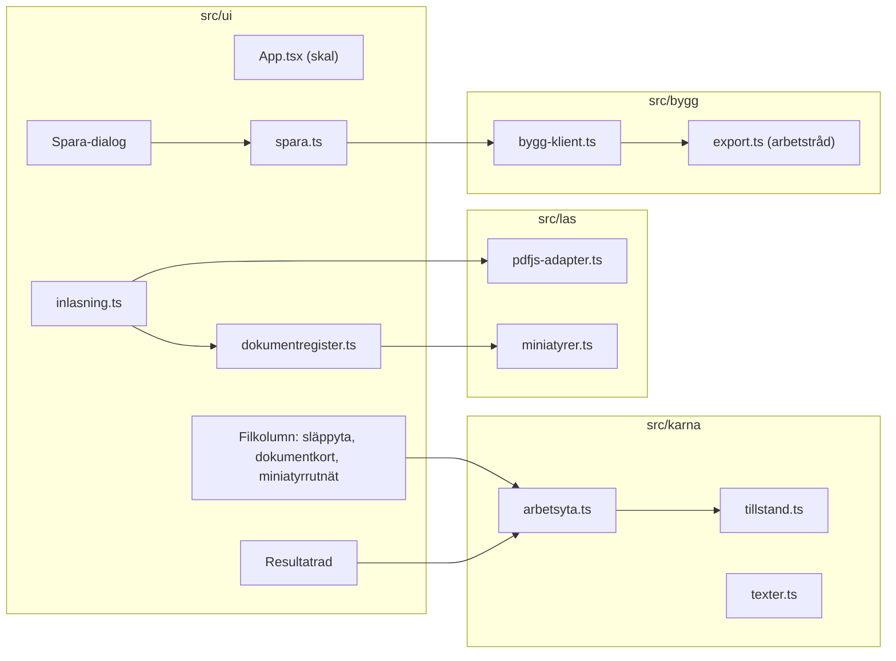

# Teknisk design: FEAT-001 – Baka ihop sidor ur flera filer

> Funktion ur: docs/implementation-plan.md · Epik: E1 Arbetsyta och ihopbakning
> Implementerar: FR-FIL-001..005, FR-SID-001..009, FR-SID-011, FR-SID-014, FR-SPA-001, FR-SPA-002, FR-SPA-007, FR-SPA-009..013 · Tvärgående: FR-ALM-006..008, FR-DOK-010
> Realiserar: UC-001, UC-002, UC-007 (utan dold information och arkivformat) · Skärmar: SCR-APP-001, SCR-APP-005 (delvis), designas i ui-design.md
> Status: Verified (G4 godkänd 2026-11-12) · Datum: 2026-11-12

## 1. Syfte

Kollegan läser in flera PDF-filer, väljer sidor ur dem, ordnar sidorna och sparar en ny PDF där sidorna är kopierade orörda. Det är kärnan i DS-01 och första riktiga värdet. Funktionen kommer först efter skelettet eftersom den prövar den viktigaste tekniska frågan: att sidor från flera filer kopieras utan att innehållet ändras (BG-009, ADR-004).

## 2. Kodläge

Designen bygger på skelettet version 0.1.1 (commit 68e9937):

- **Tillstånd** (`src/karna/tillstand.ts`): oföränderliga versioner av `Arbetsyta` med historik och lyssnare. Funktionerna `laggTillDokument`, `uniktNamn`, `uppdateraDokument`.
- **Typer** (`src/karna/typer.ts`): `Dokument { id, namn, bytes, sidantal, forstaMiniatyr }`, `Resultatsida { dokumentId, sidindex }`, `Arbetsyta { dokument, resultat }`.
- **pdf.js-adapter** (`src/las/pdfjs-adapter.ts`): `oppnaPdf(bytes)` och `ritaMiniatyr(pdf, sidindex, bredd)`. pdf.js tolkar i sin egen arbetstråd (klassisk, inbakad som blob).
- **Export** (`src/bygg/export.ts`): `bakaIhop({ dokument, sidor })` med `copyPages`, `save({ useObjectStreams: false })`. R8-testet finns i `tests/enhet/export.test.ts`.
- **Bygg-klient** (`src/bygg/bygg-klient.ts`): en arbetstråd, ett meddelande i taget, `onmessage` skrivs över per anrop.
- **Gränssnitt** (`src/ui/App.tsx`): en komponent med all logik. Texter i `src/karna/texter.ts`, värden via tokens.
- **Gränser** (ESLint): karna ↛ ui/las/bygg, las ↛ ui/bygg, bygg ↛ ui/las.
- **Testfiler:** `beslut.pdf` (3 sidor), `underskrift.pdf` (1), `blandade-format.pdf` (3, olika storlekar), `inte-pdf.pdf`.

**Avvikelser mellan dokument och kod (koden gäller):**
1. Arkitekturen ritar en egen "läs-arbetstråd" med pdf.js-adaptern. I koden ligger adaptern i huvudtråden och pdf.js gör tolkningen i sin egen arbetstråd. Effekten är densamma (tolkning utanför huvudtråden). Ingen ändring.
2. Skelettet lägger automatiskt alla sidor i resultatet vid inläsning. Det stämmer inte med FR-SID-002 och FR-FIL-003 och tas bort (beslut B1).
3. FR-SID-008 säger "flytta upp/ner", men resultatraden är horisontell (design.md, `resultatrad`). "Flytta vänster" och "Flytta höger" är samma funktion. Ingen kravändring.

## 3. Gränssnitt mellan delarna

Appen har inga nätverksgränssnitt (NFR-SEC-002). Gränssnitten här är modulernas funktioner och meddelandena till arbetstrådarna. Alla följer skelettets namngivning (svenska, camelCase, utan å/ä/ö i identifierare).

### 3.1 Arbetsyteoperationer (`src/karna/arbetsyta.ts`, nytt)

Rena funktioner. Varje operation tar nuvarande `Arbetsyta` och returnerar `Andring`:

```ts
export interface Andring {
  readonly yta: Arbetsyta        // samma objekt om inget ändrades
  readonly meddelande: string    // till statusytan (FR-SID-014); tom sträng om inget ändrades
}
```

| Funktion | Gör | Krav | Meddelande (exempel) |
| :-- | :-- | :-- | :-- |
| `laggTillDokument(yta, dok)` | Lägger dokumentet sist i listan. Resultatet ändras inte. | FR-FIL-001, FR-FIL-003 | "Beslut.pdf inläst, 3 sidor." |
| `taBortDokument(yta, dokId)` | Tar bort dokumentet och alla dess resultatsidor. | FR-FIL-005 | "Beslut.pdf borttagen. 2 sidor togs bort ur resultatet." |
| `laggTillSida(yta, dokId, sidindex)` | Lägger sidan sist i resultatet. | FR-SID-002 | "Sida 2 ur Beslut.pdf tillagd på plats 4." |
| `valjBortSida(yta, dokId, sidindex)` | Tar bort sidans förekomster ur resultatet. | FR-SID-003 | "Sida 2 ur Beslut.pdf borttagen ur resultatet." |
| `vaxlaSida(yta, dokId, sidindex)` | Lägger till om sidan inte finns i resultatet, annars väljer bort. Används av miniatyren. | FR-SID-002, FR-SID-003 | som ovan |
| `laggTillAlla(yta, dokId)` | Lägger dokumentets ännu inte valda sidor sist, i dokumentets ordning. | FR-SID-004 | "3 sidor ur Beslut.pdf tillagda. Resultatet har 4 sidor." |
| `taBortAlla(yta, dokId)` | Tar bort dokumentets alla sidor ur resultatet. | FR-SID-005 | "Alla sidor ur Beslut.pdf borttagna ur resultatet." |
| `flyttaSida(yta, resultatId, tillPlats)` | Flyttar sidan till plats `tillPlats` (från 0, begränsas till listans längd). | FR-SID-007 | "Sida 1 ur Underskrift.pdf flyttad till plats 2." |
| `flyttaSteg(yta, resultatId, riktning)` | Flyttar ett steg, `riktning` = -1 eller +1. Vid kanten: ingen ändring, meddelandet "Sidan är redan först/sist." | FR-SID-008 | som ovan |
| `taBortResultatsida(yta, resultatId)` | Tar bort just den förekomsten. | FR-SID-009 | "Sida 2 ur Beslut.pdf borttagen ur resultatet." |

Okänt `dokId` eller `resultatId` ger ingen ändring och tomt meddelande (kan hända om användaren klickar medan något tas bort). Platser i meddelanden räknas från 1. Alla meddelandetexter ligger i `texter.ts` (FR-ALM-006).

`tillstand.ts` behåller `skapaTillstand` och `uniktNamn`; den gamla `laggTillDokument` flyttar till `arbetsyta.ts` utan att lägga till sidor, och `uppdateraDokument` tas bort (miniatyrerna ligger inte längre i tillståndet, beslut B2).

### 3.2 pdf.js-adaptern (`src/las/`)

Befintligt `oppnaPdf(bytes)` och `ritaMiniatyr(pdf, sidindex, bredd)` behålls. Nytt:

```ts
// src/las/pdfjs-adapter.ts
export function stangPdf(pdf: PDFDocumentProxy): Promise<void>   // pdf.destroy(), frigör minne i pdf.js-tråden

// src/las/miniatyrer.ts (nytt)
export interface Miniatyrko {
  /** Ritar dokumentets alla sidor i ordning, en i taget; anropar klar(sidindex, url) för varje. */
  ritaAlla(dokId: string, pdf: PDFDocumentProxy, sidantal: number, klar: (sidindex: number, url: string) => void): void
  /** Avbryter väntande ritningar för dokumentet och frigör dess blob-adresser. */
  slapp(dokId: string): void
}
export function skapaMiniatyrko(bredd: number): Miniatyrko
```

- Miniatyrer ritas i 88 px bredd gånger `devicePixelRatio`, en sida åt gången så att gränssnittet svarar (architecture.md 8.5). Synliga sidor först är en senare optimering; mätningen i T3 avgör om den behövs (NFR-PERF-002).
- En sida som inte går att rita får en ersättningsruta med texten "Sidan kunde inte visas" och kan fortfarande väljas; felet stoppar inte resten.
- `slapp` anropar `URL.revokeObjectURL` för alla dokumentets bilder.

### 3.3 Bygg-arbetstråden (`src/bygg/`)

`Byggbegaran` är oförändrad. Protokollet får ett löpnummer så att svar inte blandas ihop:

```ts
// huvudtråd → arbetstråd
{ nr: number, begaran: Byggbegaran }
// arbetstråd → huvudtråd
{ nr: number, ok: true, bytes: Uint8Array }      // bytes överförs (transfer)
{ nr: number, ok: false, fel: 'kalla' | 'okant', detalj: string }
```

- `kalla`: ett källdokument gick inte att öppna eller kopiera med pdf-lib (till exempel en fil som pdf.js klarade men inte pdf-lib).
- `okant`: allt annat, även slut på minne.
- `bygg(begaran)` i `bygg-klient.ts` returnerar `Promise<Uint8Array>` eller avvisar med `Byggfel { kod, detalj }`. Arbetstråden startas vid första sparandet (NFR-PERF-004). Om arbetstråden själv kraschar (`onerror`) avvisas alla väntande anrop med `okant` och tråden startas om nästa gång.
- Begäran skickas med strukturerad kloning, alltså kopior; arbetsytans bytes ändras aldrig (FR-SPA-012).
- `bakaIhop` ändras inte i sak: sidobjekten kopieras med `copyPages`, inga innehållsflöden skrivs om (FR-SPA-007, R8), ingen kryptering (FR-SPA-009).

### 3.4 Sparande (`src/ui/spara.ts`, nytt)

Logiken bakom SCR-APP-005, skild från komponenterna så att den kan enhetstestas:

```ts
export function foreslaFilnamn(yta: Arbetsyta): string
// "<första dokumentet i resultatet, utan .pdf och löpnummer>-ihopbakad.pdf"; det sparade namnet om användaren redan sparat en gång

export function stadaFilnamn(inmatat: string, forslag: string): string
// tar bort \ / : * ? " < > | och styrtecken, trimmar, lägger till .pdf om ändelsen saknas (oavsett skiftläge),
// tomt eller bara ".pdf" → forslag; högst 200 tecken före ändelsen (FR-SPA-002)

export type Sparutfall = { ok: true; filnamn: string } | { ok: false; meddelande: string }

export async function sparaResultat(
  yta: Arbetsyta,
  filnamn: string,
  beroenden: { bygg: (b: Byggbegaran) => Promise<Uint8Array>; ladda: (bytes: Uint8Array, filnamn: string) => void },
): Promise<Sparutfall>
```

- `sparaResultat` bygger begäran av `yta.resultat` och bara de dokument som ingår, anropar `bygg` och sedan `ladda`. Den ändrar aldrig `yta`; vid fel ger den `texter.sparFel` (FR-SPA-012).
- `ladda` är skelettets befintliga Blob + `<a download>` (FR-SPA-001), flyttad till en egen funktion. Blob-adressen frigörs efter 10 sekunder.
- Medan bygget pågår är "Baka ihop och spara" och dialogens spara-knapp markerade upptagna (`aria-busy`, `aria-disabled`) och en väntindikator visas (FR-SPA-011). Ett andra klick gör ingenting.
- Efter lyckat sparande sparas filnamnet i `sparval.filnamn` och statusytan säger "Sparad som X." Arbetsytan finns kvar (FR-SPA-013).
- Panelen för dold information före sparandet (FR-DOL-001) kommer med FEAT-008. Tills dess går "Baka ihop och spara" direkt till spara-dialogen.

### 3.5 Inläsning (`src/ui/inlasning.ts`, nytt)

Flyttar skelettets `lasIn` ur `App.tsx`:

- Tar emot en `FileList` eller `File[]` från filväljaren och från släpp på arbetsytan (FR-FIL-001, FR-FIL-002). Filer läses in en i taget i den ordning de valts.
- Per fil: `oppnaPdf` → `laggTillDokument` med `uniktNamn` → miniatyrkön startas. Fel stannar vid den filen (architecture.md 8.3); meddelandet är skelettets `kundeInteLasas`. De noggranna felbeskeden (typ, storlek, lösenord, sidgräns) kommer i FEAT-002.
- Ett släpp av något som inte är filer (text, länk) ignoreras. Släpp utanför släppytan men inom fönstret räknas också, så att webbläsaren inte öppnar PDF:en själv (`preventDefault` på `dragover` och `drop` för hela dokumentet).

## 4. Dataändringar

Ingen databas och ingen migrering; tillståndet finns bara i minnet (ADR-008, FR-ALM-008). Ändringarna ligger inom entiteterna i architecture.md 8.2:

| Entitet | Ändring | Varför |
| :-- | :-- | :-- |
| `Dokument` | Ta bort `forstaMiniatyr`. Lägg till `storlekByte: number`. | Miniatyrer ligger utanför tillståndet (B2). Storleken visas i dokumentkortet ("3 sidor · 1,2 MB"). |
| `Resultatsida` | Lägg till `id: string` (löpnummer, `rs-1`, `rs-2` …). | En förekomst måste kunna flyttas och tas bort för sig, och Preact behöver stabila nycklar vid dra och släpp. Förbereder FR-SID-013. |
| `Arbetsyta` | Lägg till `sparval: { filnamn: string \| null }`. | Det namn användaren valt används nästa gång (FR-SPA-013). Övriga fält i `Sparval` kommer med FEAT-008 och FEAT-009. |

Id:n skapas med en räknare per sida och flik, inte med `crypto.randomUUID`, som kräver säker kontext och därför är osäker när filen öppnas från disken.

## 5. Komponenter



- **`dokumentregister.ts`** (ui): håller det som inte hör hemma i tillståndet, per dokument-id: pdf.js-dokumentet och miniatyrernas blob-adresser, med en enkel lyssnare så att miniatyrerna ritas om när de blir klara. När ett dokument tas bort anropas `stangPdf` och `slapp`.
- **`App.tsx`** blir ett skal som kopplar ihop kolumnerna, statusytan och dialogen. Komponenternas utseende och uppbyggnad bestäms i `ui-design.md`.
- **Statusytan:** varje `Andring.meddelande` som inte är tomt skrivs dit (`role="status"`, `aria-live="polite"`). Samma meddelande två gånger i rad läses ändå upp (texten töms först).
- **Dra och släpp i resultatraden:** HTML-dra och släpp på listans element; vid släpp räknas målplatsen ut och `flyttaSida` anropas. Tangentbord: Alt+Vänster/Höger (även Alt+Upp/Ner) anropar `flyttaSteg`, Delete och Backsteg anropar `taBortResultatsida`. Fokus följer med den flyttade sidan (NFR-ACC-002).
- **Tillgängliga namn** (FR-DOK-010): miniatyr "Sida N av M ur <dokument>" och ", vald" när den finns i resultatet (`aria-pressed`); resultatsida "Sida N av M ur <dokument>, plats P av T".

Skelettets stubbar som ersätts: auto-tillägg av alla sidor (`laggTillDokument`), bara första miniatyren (`forstaMiniatyr`), spara direkt utan dialog med fast filnamn.

## 6. Acceptanskriterier

| AC | Kriterium | Krav |
| :-- | :-- | :-- |
| AC-1 | Givet tom arbetsyta, när användaren väljer beslut.pdf och underskrift.pdf i filväljaren, så visas båda med namn och antal sidor och resultatet är tomt. | FR-FIL-001, FR-FIL-004, UC-001 |
| AC-2 | När användaren släpper en PDF-fil på arbetsytan läses den in; webbläsaren öppnar inte filen själv. | FR-FIL-002 |
| AC-3 | Givet ett resultat med sidor, när ytterligare en fil läses in, så är befintliga dokument och resultatet oförändrade. | FR-FIL-003, UC-001 2a |
| AC-4 | När användaren tar bort ett dokument försvinner det och alla dess sidor ur resultatet; övriga sidor behåller ordningen. | FR-FIL-005, UC-001 4a |
| AC-5 | Varje inläst dokument visar alla sina sidor som miniatyrer med namnet "Sida N av M ur <dokument>". | FR-SID-001, FR-DOK-010 |
| AC-6 | Klick, Enter eller Mellanslag på en ej vald miniatyr lägger sidan sist i resultatet och miniatyren visas som vald; samma åtgärd på en vald miniatyr tar bort sidan ur resultatet. | FR-SID-002, FR-SID-003 |
| AC-7 | "Lägg till alla sidor" lägger dokumentets ej valda sidor sist i dokumentets ordning; "Ta bort ur resultatet" tar bort dokumentets alla sidor. | FR-SID-004, FR-SID-005, UC-002 1 |
| AC-8 | Resultatraden visar sidorna i ordning, var och en märkt med dokument och sidnummer, och rubriken visar antalet sidor. | FR-SID-006, FR-SID-011 |
| AC-9 | En sida kan flyttas till ny plats med dra och släpp, med knapparna Flytta vänster/höger och med Alt+piltangent; en sida kan tas bort med knapp och med Delete. | FR-SID-007..009, UC-002 5, 5a |
| AC-10 | Varje tillägg, borttagning och flytt ger ett meddelande i statusytan som anger sida, dokument och plats. | FR-SID-014 |
| AC-11 | Med tomt resultat är "Baka ihop och spara" inaktiv och har en förklaring kopplad med `aria-describedby`. | FR-SPA-010, UC-007 1a |
| AC-12 | Spara-dialogen föreslår "<första dokumentet>-ihopbakad.pdf"; ett ändrat namn används med ändelsen .pdf; otillåtna tecken tas bort; väntindikator visas under bygget. | FR-SPA-001, FR-SPA-002, FR-SPA-011, UC-007 3–5 |
| AC-13 | Den sparade filen har exakt resultatets sidor i resultatets ordning; varje sidas innehållsflöde är byte för byte detsamma som i källan; filen är okrypterad och har inga behörighetsbegränsningar. | FR-SPA-007, FR-SPA-009, R8 |
| AC-14 | Om bygget misslyckas visas ett felmeddelande som säger vad som hände och vad man kan göra, och arbetsytan är oförändrad. Efter lyckat sparande finns arbetsytan kvar och kan sparas igen. | FR-SPA-012, FR-SPA-013, UC-007 4b, 6a |
| AC-15 | Hela flödet DS-01 utan stämpel (läsa in två filer, välja alla, ta bort en sida, lägga till underskriften, flytta den, spara) går med bara tangentbord; axe-core hittar inga WCAG 2.1 AA-fel i tillstånden tom, med resultat och spara-dialog. | NFR-ACC-001, NFR-ACC-002 |
| AC-16 | Noll nätverksanrop under hela flödet, även från `file://`. | NFR-SEC-002 |
| AC-17 | En PDF med 100 sidor är inläst och alla miniatyrer visas inom 5 sekunder (mätt i Chromium i CI). | NFR-PERF-002 |
| AC-18 | Alla nya texter finns i `texter.ts`, och inga dokumentdata hamnar i `localStorage`, `sessionStorage` eller IndexedDB. | FR-ALM-006..008 |

Skärmläsartestet med NVDA i Edge och VoiceOver i Safari är en manuell kontroll före release (architecture.md 8.7).

## 7. Beslut

**B1. Nya filer läggs inte automatiskt i resultatet.** Drivare: FR-SID-002 (användaren väljer sidor) och FR-FIL-003 (val oförändrade vid ny fil). Alternativ: lägga till alla sidor vid inläsning, som skelettet gör. Det sparar ett klick när man bara slår ihop hela filer, men i DS-01 måste användaren då ta bort sidor i stället, och FR-FIL-003 bryts. Följd: skelettets e2e-test ändras så att det väljer "Lägg till alla sidor" först. Det är ingen försvagning; testet följer det nya beteendet och prövar samma sak.

**B2. Miniatyrer och pdf.js-dokument ligger utanför tillståndet.** Drivare: tillståndet är oföränderligt och blir grund för ångra (FR-ALM-001, FEAT-005). Om varje färdig miniatyr vore en ny version skulle ångra-historiken fyllas av ritningar. Alternativ: flagga vissa ändringar som "utan historik". Följd: `dokumentregister.ts` i ui håller dem per dokument-id och frigör dem när dokumentet tas bort. Inget av det sparas beständigt (FR-ALM-008).

**B3. Miniatyren växlar mellan vald och ej vald.** Drivare: FR-SID-002 och FR-SID-003 samt design.md (`miniatyr` med tillståndet vald). Att välja bort en vald miniatyr tar bort alla sidans förekomster. När FR-SID-013 (samma sida flera gånger, Could) byggs i FEAT-004 läggs en separat åtgärd "Lägg till igen" till; växlingen ändras inte.

**B4. Löpnummer i byggprotokollet.** Drivare: skelettets klient skriver över `onmessage` per anrop, vilket blandar ihop svar om två byggen skulle överlappa. Spara-knappen hindrar överlapp, men protokollet ska inte bero på det.

**B5. Spara-logiken är skild från komponenterna.** Drivare: FR-SPA-012 kräver att ett misslyckat bygge prövas, och det går inte att framkalla med riktiga filer i e2e utan att lägga in testkrokar i appen. Med `bygg` som beroende prövar ett enhetstest felvägen med en falsk byggfunktion.

## 8. Eskaleringar och öppna punkter

- **Ingen arkitekturändring.** Alla dataändringar ligger inom Dokument, Resultatsida och Sparval.
- **FR-DOL-001** (panelen för dold information före sparandet) ingår inte; den byggs i FEAT-008. Fram till dess sparar appen utan granskning av dold information. Det ska framgå av CHANGELOG för de versioner som delas för test.
- **Edge och SharePoint är inte prövade av Ägaren.** Chromium prövas i CI och från `file://`. Ägarens prov i Edge och i SharePoint-testmappen står kvar som öppen risk (implementation-plan.md, skelettets klart-villkor).
- **Prestanda:** AC-17 mäts med en ny testfil på 100 sidor. Om kravet inte nås ritas synliga miniatyrer först (IntersectionObserver); det är då en ändring inom T3.
- **Ångra** (FEAT-005) bygger på att varje `Andring` med ny `yta` blir en version i historiken. Inget mer behövs här.
