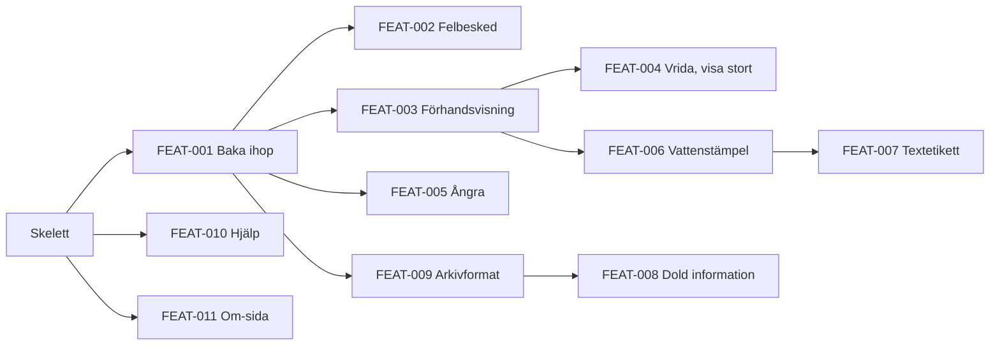

# Byggplan: PDF-bagaren

> Status: Draft · Senast uppdaterad: 2026-11-12
> Underlag: [srs.md](srs.md) v1.0 · [use-cases.md](use-cases.md) v1.0 · [architecture.md](architecture.md) v1.0 · [ux-foundations.md](ux-foundations.md) v1.0 (alla fyra finns)

## 1. Översikt

Planen bygger PDF-bagaren i tunna, genomgående funktioner, var och en från gränssnitt till sparad fil. Ordningen styrs först av **risk**: det mest osäkra prövas först, alltså att appens nätverksspärr och arbetstrådar fungerar när filen körs från SharePoint, att sidor kan kopieras orörda (ADR-004) och att arkivformatet PDF/A-2b går att uppfylla (ADR-005). Att SharePoint kör HTML-sidor har Ägaren redan prövat (2026-11-12). Därefter styr beroenden och prioritet (Must före Should före Could).

Planen har fem delmål. Efter delmål 1 kan en kollega göra DS-01 utom arkivformatet, efter delmål 3 även DS-02, och efter delmål 5 är alla Must-krav byggda och version 1.0 kan gå till grind G6. Inga datum är satta; ordningen efter de närmaste funktionerna kan ändras när vi lär oss mer.

## 2. Gångbart skelett

Det minsta som går hela vägen och prövar de största riskerna innan någon funktion byggs.

**Verkligt:**
- Repo med Vite, TypeScript och Preact som bygger **en enda HTML-fil** (ADR-001, ADR-009), med CSP-taggen först i `head` (ADR-002).
- Skalet för SCR-APP-001: sidhuvud med "Baka ihop och spara", de tre kolumnerna och statusytan, med GP MS-tokens ur tokens.json som CSS-variabler, Carlito inbakad, mörkt tema och temaväxling (FR-ALM-009).
- En PDF kan läsas in med filväljaren; läs-arbetstråden (pdf.js, skript avstängt) läser antal sidor och ritar första sidan som miniatyr.
- "Baka ihop och spara" kopierar alla sidor i filen med pdf-lib i bygg-arbetstråden och erbjuder en ny fil via webbläsarens nedladdning.
- Tillståndslagret med oföränderliga versioner (utan ångra-knappar än).
- GitHub Actions: bygge, Vitest, Playwright i Chromium och WebKit, testet "noll nätverksanrop efter laddning", kontroll av R1, R2, R5 och R7, licens- och sårbarhetskontroll, filstorlek i byggloggen.

**Stubbat:** dra och släpp, sidval och ordning, förhandsvisning, märkning, dold information, PDF/A, felbesked (bara ett allmänt felmeddelande), hjälp och om-sida.

**Klart när:**
1. CI är grön på `main`.
2. Ägaren har lagt HTML-filen i en test-mapp på SharePoint, öppnat den i Edge (och Safari om möjligt), läst in en PDF och sparat en kopia.
3. Webbläsarens nätverkslogg visar inga anrop efter laddning, och appen fungerar med nätverket avstängt.
4. Starttiden från SharePoint är mätt och noterad (mål ≤ 3 s, NFR-PERF-004).

Ägaren har redan prövat att SharePoint kör HTML-sidor. Det som återstår att pröva är att appens innehållspolicy, inbakade skript och arbetstrådar fungerar tillsammans med SharePoints egna inställningar. Går det inte stannar vi och väljer lösning med Ägaren innan funktionerna byggs.

## 3. Epics och funktioner

Funktions-ID:n (`FEAT-NNN`) är fasta och sätts i den ordning funktionerna definieras här, inte i byggordning. De numreras aldrig om; borttagna markeras `Removed`.

### E1 Inläsning och arbetsyta
Byggblock: Inläsning och validering, Arbetsyta, Tillstånd och historik, pdf.js-adapter, Meddelanden.

| ID | Funktion | FRs | UCs | Skärmar | Byggblock | Data |
| :-- | :-- | :-- | :-- | :-- | :-- | :-- |
| FEAT-001 | Baka ihop sidor ur flera filer: läsa in, välja, ordna och spara som PDF | FR-FIL-001..005, FR-SID-001..009, FR-SID-011, FR-SID-014, FR-SPA-001, FR-SPA-002, FR-SPA-007, FR-SPA-009..013 | UC-001, UC-002, UC-007 (utan dold information och PDF/A) | SCR-APP-001, SCR-APP-005 (delvis: filnamn, vanlig PDF) | Arbetsyta, Inläsning, pdf.js-adapter, Tillstånd, Export, Meddelanden | Dokument, Resultatsida, Sparval (filnamn) |
| FEAT-002 | Tydliga felbesked och gränser vid inläsning | FR-FIL-006..013 | UC-001 (undantag) | SCR-APP-001 | Inläsning och validering, Meddelanden | Dokument |
| FEAT-005 | Ångra, gör om och börja om | FR-ALM-001..004 | UC-008 | SCR-APP-001, SCR-APP-012 | Tillstånd och historik, Skal | Arbetsyta (historik) |

### E2 Förhandsvisning och sidverktyg
Byggblock: Förhandsvisning, Arbetsyta, pdf.js-adapter.

| ID | Funktion | FRs | UCs | Skärmar | Byggblock | Data |
| :-- | :-- | :-- | :-- | :-- | :-- | :-- |
| FEAT-003 | Förhandsvisning av resultatet, en sida i taget | FR-FHV-001..005, FR-FHV-007..010 | UC-002 | SCR-APP-001 | Förhandsvisning, pdf.js-adapter | Resultatsida |
| FEAT-004 | Vrida sidor, visa en sida stort och lägga till en sida två gånger | FR-SID-010 (Should), FR-SID-012 (Should), FR-SID-013 (Could) | UC-002 | SCR-APP-001, SCR-APP-007 | Arbetsyta, Förhandsvisning, Export | Resultatsida (rotation) |

### E3 Märkning
Byggblock: Paneler, Layoutmodell, Förhandsvisning, Export, typsnitt (ADR-006, ADR-007).

| ID | Funktion | FRs | UCs | Skärmar | Byggblock | Data |
| :-- | :-- | :-- | :-- | :-- | :-- | :-- |
| FEAT-006 | Vattenstämpel med genomskinlighet, opacitet, storlek och placering | FR-STA-001..012, FR-PLC-001..011, FR-FHV-006 (delvis), FR-SPA-008 (delvis) | UC-003, UC-005 | SCR-APP-002, SCR-APP-001 | Paneler, Layoutmodell, Förhandsvisning, Export | Vattenstämpel, Placering |
| FEAT-007 | Textetikett med storlek, färg, bakgrund, typsnitt och stil | FR-TXT-001..014, FR-PLC-012 (Could), FR-FHV-006 (delvis), FR-SPA-008 (delvis) | UC-004, UC-005 | SCR-APP-003, SCR-APP-001 | Paneler, Layoutmodell, Förhandsvisning, Export, typsnitt | Textetikett, Placering |

### E4 Sparande, arkivformat och dold information
Byggblock: Export, PDF/A-modul, Dold information (ADR-004, ADR-005).

| ID | Funktion | FRs | UCs | Skärmar | Byggblock | Data |
| :-- | :-- | :-- | :-- | :-- | :-- | :-- |
| FEAT-008 | Granska och rensa dold information före sparandet | FR-DOL-001..014, FR-DOL-015 (Could) | UC-006, UC-007 | SCR-APP-004, SCR-APP-001 | Dold information, Paneler, Export | Dokument (metadata, kommentarer, bilagor, formulär), Sparval |
| FEAT-009 | Spara i arkivformat PDF/A-2b med förkontroll och varning | FR-SPA-003 (Should), FR-SPA-004..006 | UC-007 | SCR-APP-005, SCR-APP-006 | PDF/A-modul, Export | Sparval (format) |

### E5 Hjälp och om-sida
Byggblock: Hjälp och om-sida, Skal.

| ID | Funktion | FRs | UCs | Skärmar | Byggblock | Data |
| :-- | :-- | :-- | :-- | :-- | :-- | :-- |
| FEAT-010 | Startläge, hjälp och kortkommandon | FR-ALM-005, FR-ALM-010 (Should), FR-DOK-001..003, FR-DOK-009 | UC-009 | SCR-APP-001, SCR-APP-008, SCR-APP-013 | Hjälp och om-sida, Skal | – |
| FEAT-011 | Om-sida med licenser, verifieringsrapport och tillgänglighetsredogörelse | FR-DOK-004..008 | UC-009, UC-010 | SCR-APP-009, SCR-APP-010, SCR-APP-011 | Hjälp och om-sida, bygget (genererar licenser och rapport) | – |

## 4. Byggordning

| Ordning | Delmål | Funktion | Varför här |
| :-- | :-- | :-- | :-- |
| 0 | M0 Skelett | Gångbart skelett | Prövar CSP, arbetstrådar och en-fil-bygget på SharePoint innan något annat byggs |
| 1 | M1 Ihopbakning | FEAT-001 | Kärnan i DS-01; prövar att sidor kopieras orörda (BG-009, ADR-004) |
| 2 | M1 | FEAT-003 | Förhandsvisningen behövs för att användaren ska förstå resultatet (MF-01) och för all märkning |
| 3 | M1 | FEAT-002 | Felbesked gör DS-04 begripligt innan fler testar |
| 4 | M1 | FEAT-005 | Ångra är billigt när tillståndslagret finns och skyddar testarnas arbete |
| 5 | M2 Arkivformat | FEAT-009 | Största kvarvarande tekniska risk (ADR-005); hur många verkliga filer klarar PDF/A-2b? |
| 6 | M3 Märkning | FEAT-006 | Kärnan i DS-02; bygger layoutmodellen som etiketten återanvänder |
| 7 | M3 | FEAT-007 | Återanvänder layoutmodell och paneler; typsnitt och tecken prövas |
| 8 | M4 Dold information | FEAT-008 | Bygger på exporten och PDF/A-rensningen; sista Must-steget i sparandet |
| 9 | M5 Komplett 1.0 | FEAT-010 | Hjälp och startläge inför användartestet (NFR-USE-001) |
| 10 | M5 | FEAT-011 | Om-sida och verifieringsrapport krävs före release (NFR-SEC-005) |
| 11 | M5 | FEAT-004 | Should och Could; vridning behövs i DS-01 men kan vänta tills Must är klart |

Vridning (FR-SID-010) är Should men förekommer i DS-01. Den kan flyttas fram direkt efter FEAT-003 om Ägaren vill pröva DS-01 fullt ut tidigt.

## 5. Första funktionen: FEAT-001 Baka ihop sidor ur flera filer

**Flöde och varför den är först.** Kollegan läser in två PDF-filer, lägger till sidor ur båda i resultatet, ändrar ordningen, tar bort en sida och sparar en ny PDF (huvudscenariot i DS-01, UC-001, UC-002 och UC-007 utan dold information och arkivformat). Den ger det första riktiga värdet och prövar den viktigaste tekniska frågan efter SharePoint: att pdf-lib kopierar sidor från flera filer utan att ändra innehållet.

**Acceptanskriterier**
1. Användaren kan läsa in flera PDF-filer på en gång, både med filväljaren och med dra och släpp; filerna läggs till och befintliga filer och val är oförändrade (FR-FIL-001..003).
2. Varje fil visas med namn och antal sidor och kan tas bort, varvid dess sidor försvinner ur resultatet (FR-FIL-004, FR-FIL-005).
3. Varje fil visar sina sidor som miniatyrer märkta med dokumentnamn och sidnummer (FR-SID-001).
4. Klick, Enter eller Mellanslag på en miniatyr lägger sidan sist i resultatet; en vald sida kan tas bort igen; "Lägg till alla sidor" och "Ta bort ur resultatet" fungerar per dokument (FR-SID-002..005).
5. Resultatraden visar sidorna i ordning, var och en märkt med dokument och sidnummer, och antal sidor visas (FR-SID-006, FR-SID-011).
6. Sidor kan flyttas med dra och släpp och med knappar eller Alt+piltangent, och tas bort i resultatraden; varje ändring läses upp i statusytan (FR-SID-007..009, FR-SID-014).
7. "Baka ihop och spara" är inaktiv med förklaring när resultatet är tomt (FR-SPA-010).
8. Spara-dialogen tar emot ett filnamn och sparar med ändelsen .pdf; väntindikator visas medan filen skapas (FR-SPA-001, FR-SPA-002, FR-SPA-011).
9. Den sparade filen har exakt de valda sidorna i vald ordning; sidornas innehållsflöden är byte för byte desamma som i källan (R8); filen är okrypterad (FR-SPA-007, FR-SPA-009).
10. Om bygget misslyckas visas ett felmeddelande och arbetsytan är oförändrad; efter sparande finns arbetsytan kvar (FR-SPA-012, FR-SPA-013).
11. Allt ovan går med bara tangentbord, och NVDA läser upp sidorna som "Sida N av M ur <dokument>" (NFR-ACC-002, FR-DOK-010).
12. Noll nätverksanrop under hela flödet (NFR-SEC-002).

**Till ui-design (skärmar):** SCR-APP-001 Arbetsyta (kolumnerna 1 Filer och 2 Resultat: `slappyta`, `dokumentkort`, `miniatyr`, `resultatrad`, statusyta) och SCR-APP-005 Spara (bara filnamn, sparar, sparad, fel).

**Till detailed-design (gränssnitt och data):**
- Domänmodellen Dokument och Resultatsida (architecture.md 8.2) som TypeScript-typer i tillståndslagret, inklusive löpnummer.
- Meddelanden mellan huvudtråd och läs-arbetstråd: öppna fil (ArrayBuffer, överförs), svar med sidantal och sidstorlekar eller feltyp; rita miniatyr (dokument, sida, bredd) → bild.
- Meddelanden mellan huvudtråd och bygg-arbetstråd: bygg (lista av dokument-bytes och resultatsidor) → PDF-bytes eller fel.
- Exportens kopiering med `copyPages` och testet R8 för oförändrade innehållsflöden.
- Testfiler i repot: två små PDF:er med text, en inskannad sida (bild), en med flera sidstorlekar.

## 6. Grundarbete

Sätts upp i skelettet och gäller alla funktioner.

- [ ] **Repo och kod:** Vite + TypeScript (strict) + Preact; mappar `src/ui`, `src/karna`, `src/las`, `src/bygg`, `src/resurser`, `tests/`, `tests/filer/`; ESLint med reglerna R1 (inga nätverks-API:er) och R3 (lagring bara i temamodulen) (architecture.md 8.8).
- [ ] **En fil och nätverksspärr:** `vite-plugin-singlefile`; CSP-taggen; arbetstrådar från `blob:`; kontrollerna R2 och R7 på byggd fil.
- [ ] **CI (GitHub Actions):** bygge, Vitest, Playwright (Chromium och WebKit), axe-core, nätverkstestet, licenskontroll mot vitlistan (R5), npm audit och OSV, filstorlek. veraPDF läggs till när FEAT-009 byggs.
- [ ] **Miljöer:** lokalt; test = Ägarens test-mapp på SharePoint; produktion = den gemensamma SharePoint-sidan (architecture.md 7).
- [ ] **Designsystem:** CSS-variabler genererade ur tokens.json; Carlito (4 snitt) inbakad; Lucide-ikoner som inbakade SVG; mörkt tema standard och ljust tema med val som sparas (FR-ALM-009).
- [ ] **Tvärgående krav:**
  - FR-ALM-006 och FR-ALM-007: alla texter på svenska i en gemensam textkatalog med meddelanden som säger vad som hände och vad man gör.
  - FR-ALM-008: ingen beständig lagring av dokumentdata (R3).
  - FR-ALM-009: temaväxling i skalet.
  - FR-DOK-010: tillgängliga namn för knappar, fält, miniatyrer och sidor; statusyta med `aria-live`.
- [ ] **Tester:** testfiler i `tests/filer/`; varje Must-krav får minst ett automatiskt test och hänvisas från RTM:s Test ref (NFR-MAINT-004).
- [ ] **Förvaltning:** versionsnummer och `CHANGELOG.md` (NFR-MAINT-003); förvaltningsinstruktion för publicering på SharePoint (NFR-MAINT-002, UC-010); mallar för verifieringsrapport (NFR-SEC-005) och tillgänglighetsredogörelse.

## 7. Risker och antaganden

| Risk eller antagande | Vad som händer om den slår in |
| :-- | :-- |
| SharePoint skickar en egen innehållspolicy som stoppar appens arbetstrådar eller inbakade skript. (Att SharePoint kör HTML-sidor är prövat av Ägaren.) | Skelettet stannar; arbetstrådarna kan köras i huvudtråden till priset av sämre svarstid, eller så väljs annan lösning med Ägaren. |
| Många verkliga filer klarar inte PDF/A-2b. | FEAT-009 kan behöva fler orsaker i förkontrollen; användarna sparar oftare som vanlig PDF. Prövas med Ägarens exempelfiler i M2. |
| pdf-lib (Cantoo-forken) klarar inte vissa filer som pdf.js kan visa. | Felbesked vid sparande (FR-SPA-012); filerna samlas som testfall; i värsta fall ett nytt ADR om bibliotek. |
| Tre kolumner ryms dåligt i 1 280 × 720. | Märkning kan bli utfällbar; avgörs i ui-design av FEAT-006. |
| Antagande: Ägaren kan ta fram exempelfiler (beslut, inskannad sida, mottagen PDF) utan känsligt innehåll till testerna. | Utan dem prövas bara egna testfiler, och PDF/A-risken blir svårare att bedöma. |
| Antagande: CI-minuter på GitHub räcker för två webbläsare och veraPDF. | Annars körs WebKit och veraPDF bara på `main`. |

**Täckning:** alla 112 Must-krav finns i en funktion eller i grundarbetet; de 5 Won't-kraven (FR-FIL-014, FR-FHV-011, FR-STA-013, FR-TXT-015, FR-DOK-011) byggs inte. Alla 13 skärmar (SCR-APP-001..013) ingår i minst en funktion. Inga öppna luckor.

Ordningen efter FEAT-003 är en levande ordning, inte ett åtagande. Den ses över vid varje grind G5.
