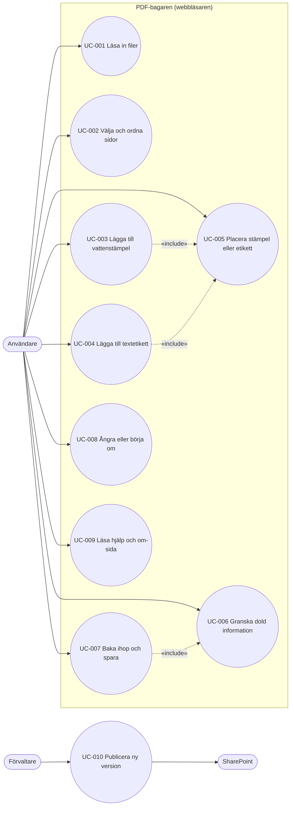

# Användningsfall: PDF-bagaren (XRB.pdf)

> Version: 1.0 · Status: Reviewed · Last updated: 2026-11-12
> Underlag: docs/srs.md, driftscenarier DS-01–DS-04 i docs/behov.md.

## Aktörer
- **Användare** – en kollega utan särskild datorvana (IN-02), med mus, tangentbord eller skärmläsare.
- **Förvaltare** – ägaren, som publicerar nya versioner (IN-03).

## Översikt

---

### UC-001: Läsa in filer

- **ID:** UC-001
- **Aktörer:** Användare (primär)
- **Beskrivning:** Användaren läser in de PDF-filer som sidorna ska hämtas från.
- **Förvillkor:** Appen är öppnad från SharePoint.
- **Eftervillkor (lyckat):** Filerna finns på arbetsytan med namn, antal sidor och miniatyrer.
- **Spåras till:** FR-FIL-001..014, FR-SID-001, FR-ALM-005, FR-DOK-002, NFR-PERF-002

**Huvudscenario**
1. Appen visar startläget med de tre stegen och ytan "Dra in PDF-filer här eller välj filer".
2. Användaren drar in två PDF-filer, eller väljer dem i filväljaren.
3. Appen visar en väntindikator per fil medan den läses in.
4. Appen visar varje fil med namn, antal sidor och miniatyrer märkta med dokumentnamn och sidnummer, och meddelar skärmläsare att filerna är inlästa.

**Alternativa flöden**
- 2a. Användaren läser in fler filer senare → appen lägger till dem och behåller befintliga val.
- 2b. Samma fil läses in två gånger → appen visar två separata dokument med löpnummer.
- 4a. Användaren tar bort en inläst fil → filen och dess sidor försvinner från arbetsytan och resultatet.

**Undantagsflöden**
- 3a. Filen är inte en PDF, är skadad eller lösenordsskyddad → appen avvisar filen med ett meddelande som namnger den och orsaken; övriga filer påverkas inte.
- 3b. Filen är större än 100 MB, eller arbetsytan skulle få fler än 500 sidor → appen avvisar filen och anger gränsen.

---

### UC-002: Välja och ordna sidor

- **ID:** UC-002
- **Aktörer:** Användare (primär)
- **Beskrivning:** Användaren väljer sidor ur de inlästa dokumenten och bestämmer deras ordning, till exempel för att ersätta en sida i ett beslut med den inskannade sidan (DS-01).
- **Förvillkor:** Minst en fil är inläst (UC-001).
- **Eftervillkor (lyckat):** Resultatet innehåller de valda sidorna i önskad ordning och riktning, och förhandsvisningen visar dem.
- **Spåras till:** FR-SID-002..014, FR-FHV-001..011, NFR-PERF-001, NFR-USE-001

**Huvudscenario**
1. Användaren väljer "välj alla" för originaldokumentet.
2. Appen lägger sidorna i resultatraden, märkta med dokument och sidnummer, och visar antalet sidor.
3. Användaren tar bort beslutssidan ur resultatraden.
4. Användaren väljer den inskannade sidan i det andra dokumentet; appen lägger den sist.
5. Användaren drar den inskannade sidan till beslutssidans plats.
6. Appen uppdaterar förhandsvisningen och visar "Sida N av M" och sidans ursprung.

**Alternativa flöden**
- 5a. Användaren flyttar sidan med "flytta upp/ner" eller tangentbordet → samma resultat; skärmläsaren meddelar den nya platsen.
- 5b. Den inskannade sidan ligger ner → användaren vrider den 90 grader; förhandsvisningen visar den rättvänd.
- 6a. Användaren förstorar en miniatyr eller bläddrar i förhandsvisningen med piltangenterna.
- 6b. Användaren väljer samma sida en gång till → en ytterligare förekomst läggs till (Could).

**Undantagsflöden**
- 3a. Användaren väljer bort alla sidor → förhandsvisningen visar en förklaring av hur man väljer sidor, och spara är inaktivt.

---

### UC-003: Lägga till vattenstämpel

- **ID:** UC-003
- **Aktörer:** Användare (primär)
- **Beskrivning:** Användaren märker resultatet med en bild, till exempel en logotyp med genomskinlig bakgrund (DS-02).
- **Förvillkor:** Resultatet innehåller minst en sida.
- **Eftervillkor (lyckat):** Stämpeln ligger på valda sidor med vald opacitet och storlek och syns i förhandsvisningen.
- **Spåras till:** FR-STA-001..013, FR-FHV-005, FR-FHV-006, FR-PLC-007

**Huvudscenario**
1. Användaren väljer en PNG-bild som vattenstämpel.
2. Appen lägger stämpeln på de valda sidorna i nedre högra hörnet med 100 % opacitet; genomskinliga delar förblir genomskinliga.
3. Användaren sänker opaciteten med reglaget.
4. Användaren gör stämpeln mindre genom att dra i ett hörn.
5. Användaren väljer att stämpeln ska ligga på alla sidor utom den första genom att avmarkera sida 1.
6. Appen visar ändringarna i förhandsvisningen.
7. Användaren placerar stämpeln (UC-005).

**Alternativa flöden**
- 4a. Användaren anger storleken i sifferfältet eller med knapparna större och mindre.
- 5a. "Alla sidor" är valt och användaren lägger till en sida senare → den nya sidan får också stämpeln.
- 7a. Användaren väljer en annan bild → bilden ersätts och inställningarna behålls.
- 7b. Användaren tar bort stämpeln → den försvinner från alla sidor.

**Undantagsflöden**
- 1a. Bilden är inte PNG eller JPEG, är skadad eller större än 20 MB → appen avvisar den med ett meddelande.

---

### UC-004: Lägga till textetikett

- **ID:** UC-004
- **Aktörer:** Användare (primär)
- **Beskrivning:** Användaren lägger en rad text, till exempel "UTKAST", på valda sidor.
- **Förvillkor:** Resultatet innehåller minst en sida.
- **Eftervillkor (lyckat):** Etiketten ligger på valda sidor med valt utseende och syns i förhandsvisningen.
- **Spåras till:** FR-TXT-001..015, FR-PLC-006, FR-FHV-005, FR-FHV-006, NFR-USE-001

**Huvudscenario**
1. Användaren skriver texten i etikettfältet.
2. Appen lägger etiketten centrerat i sidhuvudet på de valda sidorna, i 12 pt svart Carlito utan bakgrund.
3. Användaren väljer röd textfärg, vit bakgrund och fetstil, och ändrar storleken.
4. Användaren väljer vilka sidor etiketten ska ligga på.
5. Appen visar ändringarna i förhandsvisningen.

**Alternativa flöden**
- 3a. Användaren väljer ett annat inbakat typsnitt eller kursiv stil.
- 4a. "Alla sidor" är valt och en sida läggs till senare → den nya sidan får också etiketten.
- 5a. Användaren tömmer fältet → ingen etikett läggs ut; eller tar bort etiketten → den försvinner från alla sidor.

**Undantagsflöden**
- 1a. Texten blir längre än 200 tecken → appen tar inte emot fler tecken och visar gränsen.
- 3b. Typsnittet saknar ett tecken i texten → appen visar en varning som namnger tecknet.

---

### UC-005: Placera stämpel eller etikett

- **ID:** UC-005
- **Aktörer:** Användare (primär)
- **Beskrivning:** Användaren flyttar vattenstämpeln eller textetiketten så att den inte täcker något viktigt och inte hamnar för nära kanten.
- **Förvillkor:** En vattenstämpel eller textetikett finns.
- **Eftervillkor (lyckat):** Objektet har en placering som gäller på alla dess sidor och syns innanför säkerhetsmarginalen.
- **Spåras till:** FR-PLC-001..012, NFR-ACC-002

**Huvudscenario**
1. Appen visar en säkerhetsmarginal på 5 mm i förhandsvisningen.
2. Användaren väljer en färdig placering, till exempel övre högra hörnet, och ändrar avståndet till kanten till 15 mm.
3. Appen placerar objektet på samma ställe på alla dess sidor, räknat från samma hörn, även på sidor med annan storlek eller riktning.

**Alternativa flöden**
- 2a. Användaren drar objektet fritt i förhandsvisningen.
- 2b. Användaren flyttar objektet med piltangenterna, 1 mm per tryck eller 10 mm med Skift.

**Undantagsflöden**
- 3a. Objektet hamnar inom säkerhetsmarginalen på någon sida → appen visar en varning som anger sidorna.
- 3b. En flytt eller storleksändring skulle lägga objektet utanför sidan → appen håller det innanför kanten.
- 3c. Stämpel och etikett överlappar → appen visar en varning (Could).

---

### UC-006: Granska dold information

- **ID:** UC-006
- **Aktörer:** Användare (primär)
- **Beskrivning:** Användaren ser och justerar dold information innan filen sparas.
- **Förvillkor:** Resultatet innehåller minst en sida.
- **Eftervillkor (lyckat):** Resultatets metadata, kommentarer, bilagor och formulärfält är som användaren valt; otillåtet innehåll är markerat för borttagning.
- **Spåras till:** FR-DOL-001..015

**Huvudscenario**
1. Appen visar panelen "Dold information" för de dokument vars sidor ingår.
2. Appen visar metadata per dokument och resultatets förifyllda titel, författare, ämne och nyckelord.
3. Användaren ändrar författare och titel.
4. Appen listar kommentarer, bilagor och formulärfält; användaren tar bort en kommentar och en bilaga.
5. Appen anger att skript och bilagor som PDF/A-2 inte tillåter tas bort.
6. Användaren fortsätter till sparandet (UC-007).

**Alternativa flöden**
- 2a. Ingen dold information finns utöver metadata → panelen visar "Ingen dold information hittades".
- 4a. Användaren ändrar texten i en kommentar i stället för att ta bort den.

**Undantagsflöden**
- Inga utöver UC-007.

---

### UC-007: Baka ihop och spara

- **ID:** UC-007
- **Aktörer:** Användare (primär)
- **Beskrivning:** Användaren skapar resultatfilen och sparar den på sin dator.
- **Förvillkor:** Resultatet innehåller minst en sida.
- **Eftervillkor (lyckat):** En PDF/A-2b-fil (eller vanlig PDF efter val) som motsvarar förhandsvisningen är sparad på datorn; arbetsytan finns kvar.
- **Spåras till:** FR-SPA-001..013, FR-DOL-001, FR-ALM-004, NFR-PERF-003, NFR-SEC-001, NFR-COMP-004, NFR-COMP-005

**Huvudscenario**
1. Användaren väljer "Baka ihop och spara".
2. Appen visar panelen för dold information (UC-006); användaren bekräftar.
3. Appen föreslår filnamnet "<första dokumentets namn>-ihopbakad.pdf"; användaren behåller eller ändrar det.
4. Appen visar en väntindikator och skapar filen som PDF/A-2b, med sidorna oförändrade och stämpel och etikett ovanpå.
5. Webbläsaren sparar filen på användarens dator.
6. Appen behåller arbetsytan.

**Alternativa flöden**
- 4a. En sida hindrar PDF/A-2b → appen listar sidorna och orsaken; användaren tar bort sidorna, avbryter eller sparar som vanlig PDF.
- 6a. Användaren justerar något och sparar igen.

**Undantagsflöden**
- 1a. Resultatet saknar sidor → knappen är inaktiv och appen förklarar varför.
- 4b. Skapandet misslyckas → appen visar ett felmeddelande och arbetsytan är oförändrad.
- 6b. Användaren stänger fliken utan att spara → webbläsaren frågar om användaren vill lämna sidan.

---

### UC-008: Ångra eller börja om

- **ID:** UC-008
- **Aktörer:** Användare (primär)
- **Beskrivning:** Användaren rättar ett misstag eller börjar från början.
- **Förvillkor:** Användaren har gjort minst en ändring.
- **Eftervillkor (lyckat):** Arbetsytan är i önskat tidigare läge, eller tom.
- **Spåras till:** FR-ALM-001..004

**Huvudscenario**
1. Användaren väljer "Ångra" eller trycker Ctrl+Z (Cmd+Z).
2. Appen återställer den senaste ändringen.

**Alternativa flöden**
- 1a. Användaren väljer "Gör om" → den ångrade ändringen görs om.
- 1b. Användaren väljer "Börja om" och bekräftar → arbetsytan töms.

**Undantagsflöden**
- 1c. Användaren avbryter bekräftelsen för "Börja om" → inget ändras.

---

### UC-009: Läsa hjälp och om-sida

- **ID:** UC-009
- **Aktörer:** Användare (primär)
- **Beskrivning:** Användaren får hjälp eller kontrollerar vad appen gör med uppgifterna.
- **Förvillkor:** Appen är öppen.
- **Eftervillkor (lyckat):** Användaren har läst det hen behövde.
- **Spåras till:** FR-DOK-001..011, FR-ALM-009, FR-ALM-010

**Huvudscenario**
1. Användaren öppnar hjälpen.
2. Appen visar steg-för-steg-beskrivningar av de två vardagsfallen och kortkommandona.
3. Användaren öppnar om-sidan.
4. Appen visar namn, version och datum, att inga filer lämnar datorn, licensförteckningen och länkar till verifieringsrapporten och tillgänglighetsredogörelsen.

**Alternativa flöden**
- 1a. Användaren använder hjälpknappen vid ett steg och får den korta hjälptexten för steget.
- 4a. Användaren byter till ljust tema.

**Undantagsflöden**
- Inga.

---

### UC-010: Publicera ny version

- **ID:** UC-010
- **Aktörer:** Förvaltare (primär), SharePoint (sekundär)
- **Beskrivning:** Ägaren lägger upp en ny version av appen så att kollegorna kan använda den (DS-03).
- **Förvillkor:** En ny version är byggd, testad och har en verifieringsrapport.
- **Eftervillkor (lyckat):** Kollegorna öppnar den nya versionen från SharePoint utan att installera något.
- **Spåras till:** NFR-MAINT-001..004, NFR-SEC-004, NFR-SEC-005, FR-DOK-004, FR-DOK-007

**Huvudscenario**
1. Förvaltaren läser versionshistoriken och verifieringsrapporten för den nya versionen.
2. Förvaltaren följer förvaltningsinstruktionen och ersätter appfilen på SharePoint.
3. Förvaltaren öppnar appen från SharePoint och ser det nya versionsnumret på om-sidan.

**Alternativa flöden**
- 3a. Något fungerar inte → förvaltaren lägger tillbaka den förra versionen enligt instruktionen.

**Undantagsflöden**
- 1a. Verifieringsrapporten visar ett underkänt krav → versionen publiceras inte.
