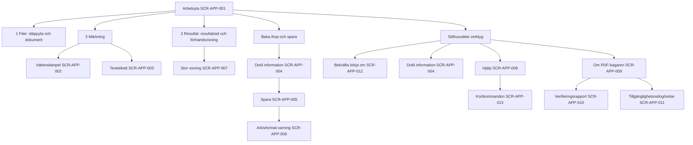
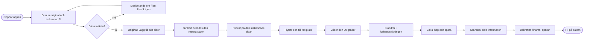
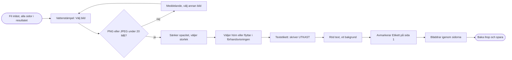
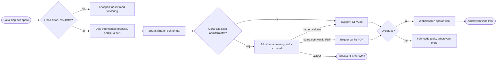
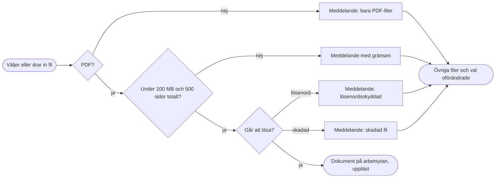

# UX-grund: PDF-bagaren

> Status: Draft · Senast uppdaterad: 2026-11-12
> Underlag: [srs.md](srs.md) v1.0 · [architecture.md](architecture.md) v1.0 · [use-cases.md](use-cases.md) v1.0
> Designsystem: **[design.md](design.md) + [tokens.json](tokens.json)** (enda källan för färger, typsnitt, mått och komponenter; det här dokumentet hänvisar dit och upprepar inga värden)

## 1. Översikt

PDF-bagaren är en webbapp där kollegor sätter samman sidor ur flera PDF-filer, lägger på en vattenstämpel och en textetikett och sparar resultatet som arkivformat (PDF/A-2b) på sin dator. Allt sker i webbläsaren (architecture.md, ADR-001).

Appen har **ett gränssnitt**: arbetsytan i en webbläsare på datorn, ytkod `APP`. Det finns ingen mobilvy, inget administrationsgränssnitt och ingen inloggning. Ägarens förvaltning sker i GitHub och SharePoint och har inget eget gränssnitt i appen.

Designkälla: GP MS, inläst som designfil och kompletterad med det som saknas (design.md §9).

---

## Del A – Gemensam grund (sammanfattning; värdena finns i design.md)

### A1. Visuell riktning

Mörkt och lugnt enligt GP MS: skiffer som grund, paneler i petrol, ljus text, en grön huvudknapp och gult bara för fokus och varningar. Dokumenten är huvudsaken och gränssnittet håller sig i bakgrunden. Ljust tema finns som val. Se design.md §1.

### A2. Röst och ton

Du-tilltal, klartext och korta meningar på svenska (FR-ALM-006, FR-ALM-007). Knappar säger vad som händer. Meddelanden säger vad som hände, vilken fil det gäller och vad man kan göra. Tekniska ord som PDF/A förklaras ("arkivformatet (PDF/A)"). Se design.md §6.

### A3. Designspråk

Åtta GP MS-färger via rolltokens, Calibri med inbakad Carlito, brödtext 16 px och en tät men luftig layout med tre kolumner som motsvarar stegen. Tokens: design.md §2 och tokens.json. Komponenter och tillstånd: design.md §4.

### A4. Tillgänglighet

WCAG 2.1 AA enligt EN 301 549 [NFR-ACC-001]. DS-01 och DS-02 ska gå att genomföra helt med tangentbord och med NVDA i Edge och VoiceOver i Safari [NFR-ACC-002]. Varje dra-och-släpp har ett tangentbordsalternativ, utfall läses upp i en statusyta och information bärs aldrig bara av färg. Mekaniska regler: design.md §5.

### A5. Principer för hela appen

1. **Stegen syns alltid.** Kolumnerna heter "1 Filer", "2 Resultat" och "3 Märkning", och huvudknappen "Baka ihop och spara" ligger alltid på samma plats uppe till höger (FV-001, FR-DOK-002).
2. **Det du ser är det du får.** Förhandsvisningen visar alltid den aktuella sidan med stämpel och etikett exakt som de sparas (MF-02, ADR-006).
3. **Ursprunget syns överallt.** Varje sida i resultatet är märkt med dokument och sidnummer, både i resultatraden och under förhandsvisningen (BH-002, FR-SID-006, FR-FHV-007).
4. **Allt kan ångras.** Ångra och Gör om finns i sidhuvudet och med Ctrl+Z / Ctrl+Y (Cmd på Mac). Bara "Börja om" kräver bekräftelse, eftersom den tömmer allt (FR-ALM-001..003).
5. **Fel stannar där de uppstår.** Ett felmeddelande visas i det område det gäller, namnger filen och säger vad man kan göra, och inget annat ändras (BH-020).
6. **Inget försvinner i smyg.** Dold information som tas bort visas före sparandet med orsak (FR-DOL-010, FR-DOL-012).
7. **Samma ord överallt:** fil, sida, resultat, vattenstämpel, textetikett, arkivformat (PDF/A), dold information.

---

## Del B – Gränssnitt

### B1. Arbetsytan – ytkod `APP`

#### Användare och uppgifter

Användare är **kollegorna** (SRS §2.3, IN-02): utan särskild datorvana, använder appen då och då, ska klara uppgiften första gången utan instruktioner, kan använda tangentbord eller skärmläsare. **Ägaren** (IN-01) använder samma gränssnitt för att prova nya versioner och läser om-sidan och verifieringsrapporten.

Uppgifter, i ordning efter hur ofta de görs:

1. Sätta ihop sidor ur två eller flera filer, till exempel ett beslut med en inskannad underskriven sida (DS-01; UC-001, UC-002, UC-007).
2. Märka en PDF med logotyp eller text som "UTKAST" (DS-02; UC-003, UC-004, UC-005, UC-007).
3. Kontrollera och rensa dold information före sparande (UC-006).
4. Rätta ett misstag: ångra, ta bort en fil eller börja om (UC-008).
5. Läsa hjälp, om-sida och verifieringsrapport (UC-009).

Sammanhang: arbetsdator med Edge (eller Safari på Mac), fönster från 1 280 × 720 px, mus och tangentbord.

#### Informationsarkitektur och navigering

Allt arbete sker i **en vy** (SCR-APP-001). Det finns ingen meny med sidor; i stället ligger stegen som kolumner bredvid varandra, och allt annat öppnas som dialoger ovanpå arbetsytan. Det håller användaren kvar i en och samma bild och gör att inget arbete kan "försvinna" vid navigering. Sidhuvudet har verktyg (Ångra, Gör om, Börja om, Dold information, Hjälp, Om, Tema) och huvudknappen.

#### Viktiga flöden

**Beslut med inskannad namnteckning** [DS-01; UC-001, UC-002, UC-007]

**Märka en mottagen PDF** [DS-02; UC-001, UC-003, UC-004, UC-005, UC-007]

**Baka ihop och spara** [UC-006, UC-007]

**Fil som inte kan läsas in** [UC-001, undantagsflöden; BH-020]

#### Skärmar

ID:na är stabila. Nya skärmar får nästa lediga nummer; borttagna markeras `Removed` och numreras aldrig om.

| ID | Skärm | Syfte | Viktiga tillstånd | Krav (urval) |
| :-- | :-- | :-- | :-- | :-- |
| SCR-APP-001 | Arbetsyta | Huvudvyn med sidhuvud, 1 Filer, 2 Resultat med förhandsvisning, 3 Märkning och statusyta | startläge (inga filer, tre steg visas), läser in, med filer utan resultat, med resultat, fel i område, osparat arbete vid stängning | FR-FIL-*, FR-SID-*, FR-FHV-*, FR-PLC-*, FR-ALM-001..010, FR-DOK-001, FR-DOK-002, FR-DOK-010, FR-SPA-010 |
| SCR-APP-002 | Vattenstämpel (panel) | Välja bild, opacitet, storlek, placering och sidor för stämpeln | ingen bild, bild vald, bild avvisad, nära kant (varning) | FR-STA-001..012, FR-PLC-001..011 |
| SCR-APP-003 | Textetikett (panel) | Skriva text och välja storlek, färg, bakgrund, typsnitt, stil, placering och sidor | tom (ingen etikett), med text, teckengräns nådd, tecken saknas i typsnitt (varning), nära kant (varning) | FR-TXT-001..014, FR-PLC-001..011 |
| SCR-APP-004 | Dold information (dialog) | Visa och ändra metadata, kommentarer, bilagor, formulärfält och skript i berörda dokument | ingen dold information, med innehåll, objekt som tas bort med orsak | FR-DOL-001..014 |
| SCR-APP-005 | Spara (dialog) | Filnamn och format, starta bygget, visa utfall | redo, kontrollerar, sparar (väntindikator), sparad, fel | FR-SPA-001..004, FR-SPA-011..013 |
| SCR-APP-006 | Arkivformat-varning (dialog) | Lista sidor som hindrar PDF/A-2b med orsak och låta användaren ta bort dem, avbryta eller spara som vanlig PDF | en eller flera sidor | FR-SPA-005, FR-SPA-006 |
| SCR-APP-007 | Stor visning av sida (dialog) | Visa en sida i stort format | – | FR-SID-012 (Should) |
| SCR-APP-008 | Hjälp (dialog, stor) | Stegen, steg-för-steg för DS-01 och DS-02, kortkommandon | – | FR-DOK-001, FR-DOK-003, FR-DOK-009 |
| SCR-APP-009 | Om PDF-bagaren (dialog, stor) | Namn, version och datum, att inget lämnar datorn, licensförteckning, länkar till rapport och redogörelse | – | FR-DOK-004..006 |
| SCR-APP-010 | Verifieringsrapport (dialog, stor) | Visa verifieringsrapporten för informationssäkerhet för den här versionen | – | FR-DOK-007, NFR-SEC-005 |
| SCR-APP-011 | Tillgänglighetsredogörelse (dialog, stor) | Visa redogörelsen enligt DOS-lagen | – | FR-DOK-008 |
| SCR-APP-012 | Bekräfta börja om (dialog) | Bekräfta att arbetsytan töms helt | – | FR-ALM-003 |
| SCR-APP-013 | Kortkommandon (dialog) | Lista alla kortkommandon; öppnas med ? eller från hjälpen | – | FR-ALM-010 (Should), FR-DOK-009 |

#### Komponenter för den här ytan

Eftersom appen har en enda yta finns alla komponenter i design.md §4. De som är särskilda för PDF-bagaren är `slappyta`, `dokumentkort`, `miniatyr`, `resultatrad`, `forhandsvisning`, `placeringsvaljare` och `fargval`.

#### Tokenavvikelser

Inga. Ytan använder grundens tokens.

---

## Del D – Öppna frågor och risker

| Fråga eller risk | Hur den hanteras |
| :-- | :-- |
| Räcker 1 280 × 720 för tre kolumner, resultatrad och en läsbar förhandsvisning? | Prövas med det första bygget; om förhandsvisningen blir för liten kan Märkning bli en utfällbar panel. |
| Förstår en ny användare att man klickar på en miniatyr för att lägga till sidan? | Det är den viktigaste osäkerheten för FV-001. Hjälptext i resultatraden när den är tom, och användartestet (NFR-USE-001) avgör. |
| Ska dold information granskas i en egen dialog före sparandet, eller räcker en sammanfattning? | Egen dialog enligt FR-DOL-001; om användartestet visar att det bromsar kan dialogen visa "Ingen dold information hittades" och gå direkt vidare. |
| Lucide som ikonuppsättning är inte en del av GP MS. | Ägaren kan byta när organisationen har egna ikoner; ikonerna kompletterar alltid text. |
| Ljust tema har lägre marginal för felikonens kontrast (3,2:1). | Felmeddelanden bärs av text och ikon; mäts igen i tillgänglighetsgranskningen. |
| Skärmläsarupplevelsen för resultatraden (flytta sidor med knappar och kortkommandon) är inte prövad. | Prövas tidigt med NVDA i ui-design av första funktionen. |
